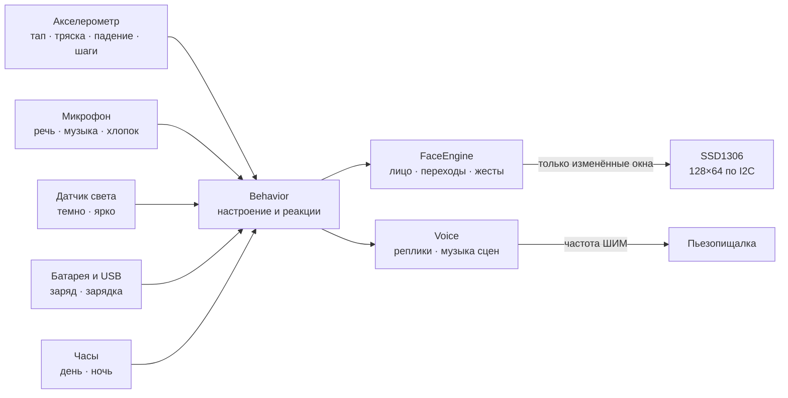

<div align="center">


# Брелок с эмоциями

**Брелок на рюкзак с белым OLED-экраном, на котором живёт персонаж.**<br>
Он моргает, оглядывается, смеётся, злится, засыпает в темноте и реагирует на тапы, тряску, звук и свет.

[](https://github.com/olerast67/emotion-keychain/actions/workflows/ci.yml)


[](LICENSE.md)

[Движок](docs/engine.md) · [Эмоции](docs/emotions.md) · [Голос](docs/sound.md) · [Встречи](docs/encounters.md) · [Железо](docs/hardware.md) · [Плата](hardware/rev-b/README.md) · [Корпус](hardware/rev-b/case/README.md) · [Энергия](docs/power.md) · [План](docs/plan.md)

</div>

---

## Что он умеет

- **139 эмоций.** Радость, смех, грусть, злость, удивление, сон, головокружение, «слушает», «кушает» на зарядке — и мемные: орущий сойджак, Ленни, `¯\_(ツ)_/¯`, FFFUUU, `$_$`, переворот стола. [Весь каталог](docs/emotions.md).
- **Каждая эмоция живая.** Моргание, взгляд, подвижные зрачки и фирменный жест: дыхание, брови, прищур, наклон головы, «болтовня». Переходы плавные, смена формы глаз спрятана за морганием.
- **Характер.** Персонаж сам выбирает реакцию на ситуацию: тап, тряску, падение, хлопок, музыку, темноту, холод, зарядку, долгое одиночество. Варианты реакций чередуются, у раздражения есть лестница от «-_-» до переворота стола.
- **Двух одинаковых не бывает.** Характер и внешность выводятся из серийного номера чипа. Один брелок из ста — легендарный, с золотым кибер-глазом.
- **Дружба брелоков.** Встречи день за днём поднимают дружбу от NEW FRIEND до BFF. Старший брелок дарит младшему эмоцию, старые знакомые иногда шепчутся шифром.
- **Растёт вместе с хозяином.** На старте 44 эмоции, остальные открываются «имплантами» за дни вместе, касания, шаги и встречи — примерно за месяц. Сверху — серия дней вместе и 24 достижения с кубком: от FIRST FRIEND до MARATHON и 1337.
- **Сюрпризы и пасхалки.** Иногда сам «взламывает» что-то, прячется, перезагружается, выдаёт ERROR 404: MOOD NOT FOUND, синий экран «:(» или визор-сканер. Празднует Новый год, Хэллоуин и твой день рождения. Знает день π, POEKHALI! 12 апреля, MAY THE 4TH, DONT PANIC, 1 апреля и пятницу 13-е. В 13:37 переходит в H4X0R MODE. Отвечает на секретный стук «Shave and a haircut». На зарядке гоняет логотип, пока тот не попадёт точно в угол.
- **Батарея — часть характера.** Зарядка показывает наливающуюся батарею с процентом. Голодный благодарит, что покормили. При малом заряде сам переходит в экорежим, при пустой батарее желает спокойной ночи.
- **Десять характеров:** игрун, ворчун, соня, скромник, любопытный, пофигист, драма, глюк, хитрец, добряк. У каждого своё лицо в покое, свой ответ на касания, свои занятия, темп и голос. Характер выводится из серийного номера чипа.
- **Голос.** Пьезопищалка отвечает на касания короткими «словами» из нот, как R2-D2. У каждого характера своя нота и манера: игрун скачет, ворчун бурчит, соня сползает вниз, хитрец хихикает тройками. Сцены играют свою музыку — от рукопожатия модема при «взломе» до Happy Birthday. Ночью говорит только о важном, и тихо. [Как он звучит](docs/sound.md).
- **Секретный разговор.** После дуэли два брелока переговариваются пищалками шифром: реплики по очереди, на экранах — знаки в пузырях, в конце мелькает «расшифровка» и ACCESS DENIED.
- **Три темы.** Классика. Киберпанк: загрузка OLERAST LINK, прицел, который щёлкает по делу, и сбои сигнала. Ретро: лицо крупными пикселями, как на старой карманной консоли.
- **Экран не гаснет**, пока его кто-то может видеть, и при этом экономит батарею. Кадр рисуется только при изменении лица, на экран уходят только изменённые участки, процессор спит между кадрами.
- **Один код везде:** прошивка своей платы на nRF52840, стенд на ESP32, симуляторы на ПК и страница в браузере.

<div align="center">

</div>

## Как это работает



Подробно — в [описании движка](docs/engine.md).

## Устройство

| | |
|---|---|
| **Экран** | белый OLED 0.96″, SSD1306, 128×64 |
| **Мозг** | nRF52840: модуль Raytac MDBT50Q на своей плате rev B |
| **Датчики** | акселерометр LIS3DH, PDM-микрофон, датчик света LTR-303ALS, кнопка |
| **Голос и отдача** | пьезопищалка, вибромотор |
| **Питание** | Li-Po с платой защиты: 402025, 502025 или 602025 (150–250 мА·ч); зарядка по USB-C током 100 мА, только при 3–42 °C |
| **Плата** | 30×46 мм и ушко для кольца, 4 слоя, файлы для заказа на JLCPCB и PCBWay |
| **Корпус** | акриловый «бутерброд» под лазерную резку: 35×51 мм, толщина 18.8, 19.8 или 20.8 мм — три версии S, M, L под ячейки разной толщины |
| **Автономность** | обычный день — ≈11, 15 и 18 дней (S, M, L); 16 ч лица в сутки — ≈3–5 дней. Оценка по симуляции платы |

Компоненты, стек плат и закупки — в [docs/hardware.md](docs/hardware.md), расчёт тока — в [docs/power.md](docs/power.md).

## Своя плата и корпус

<div align="center">

</div>

<table>
<tr>
<td width="50%"></td>
<td width="50%"></td>
</tr>
<tr>
<td align="center">В сборе: экран за прозрачной крышкой</td>
<td align="center">В разборе: слои акрила, модуль экрана и плата</td>
</tr>
</table>

**Плата rev B** готова к заказу: DRC — 0 ошибок и 0 несоединённых.

- **Генерация из одного описания.** Схема, расстановка, разводка, Gerber, BOM и CPL строятся скриптами из [`netlist.py`](hardware/rev-b/gen/netlist.py), в KiCad руками ничего не правится.
- **Четыре слоя.** L2 — сплошная земля. L3 — шины питания и медленные сигналы. Антенна у правого края, под ней меди нет.
- **Трассировка в три прохода.** Шины питания кладёт свой трассировщик, сигналы — Freerouting, остаток доводит собственный трассировщик по трём слоям.
- **Монтаж.** Мелочь с двух сторон ставит завод — JLCPCB или PCBWay. Руками — модуль экрана, ячейка и вибромотор, около 15 минут.

**Корпус** — слои акрила, стянутые четырьмя винтами M2. Экран и плата видны насквозь, торцы закрыты. Три версии, S, M и L, отличаются только ячейкой и верхней рамкой вокруг неё: на ушках рамок лежит модуль экрана, покупных стоек нет. Сверху выходит ушко для кольца, снизу — вырез под USB-C, справа — толкатель кнопки. Файлы резки в SVG и DXF лежат в [`hardware/rev-b/case/out`](hardware/rev-b/case/out).

**Для заказа платы ничего запускать не нужно:** она разведена и проверена, файлы для завода лежат в [`hardware/rev-b/out`](hardware/rev-b/out) (одна плата) и [`hardware/rev-b/out/panel`](hardware/rev-b/out/panel) (панель для монтажа) и загружаются как есть — по [README платы](hardware/rev-b/README.md#заказ-на-jlcpcb). Генераторы нужны, только чтобы изменить плату или корпус:

```sh
cd hardware/rev-b/gen
python3 build.py fab        # DRC и файлы для заказа → out/, out/panel/ (панель — через KiKit, см. README платы)
cd ../case && python3 case.py && python3 viewer.py   # корпус и 3D-просмотр
```

`build.py place --force` и `build.py route` расставляют и разводят плату заново (для `route` нужны Java 21 и Freerouting). Без `--force` `place` разведённую плату не затрёт, а `fab` не выпустит файлы с платы без дорожек, с ошибками DRC или несоединёнными площадками. Вернуть плату и файлы из репозитория:

```sh
git checkout -- hardware/rev-b/keychain-rev-b.kicad_pcb hardware/rev-b/Keychain.pretty hardware/rev-b/out
```

`viewer.py` собирает `case/out/keychain-3d.html`: модель брелока с вращением и разбором по слоям. Открывается в браузере без сервера.

## Быстрый старт

Нужны CMake 3.16+ и компилятор с C++20 (GCC 10+ или Clang 12+). SDL2 нужен только для оконного симулятора.

```sh
cmake -S . -B build -DCMAKE_BUILD_TYPE=Release
cmake --build build

./build/face_tests                              # тесты движка
./build/facegen list                            # все эмоции и клипы
./build/facegen anim lenny out/lenny.gif        # эмоция в GIF
./build/facegen trans neutral laugh out/t.gif   # переход между эмоциями
./build/facegen sheet out/all.gif --scale 2     # контактный лист всех эмоций
./build/facegen bench                           # кадры и нагрузка на шину по каждой эмоции
./build/facegen scene hack out/hack.gif         # сцена-сюрприз в GIF (--theme cyber — киберпанк)
./build/facegen id 9                            # какой персонаж получится из серийного номера
./build/facegen sound all out/voice.wav         # голос брелока в WAV (--serial N — другой брелок)
./build/facesim                                 # окно с лицом (если есть SDL2)
```

### Симулятор в браузере

```sh
sim/web/build.sh    # нужны clang с целью wasm32 и wasm-ld (пакет lld)
```

Откройте `sim/web/dist/index.html`, сервер не нужен. На странице:

- тапы прямо по экрану;
- ситуации: тряска, падение, музыка, темнота, зарядка;
- голос через кнопку «Пищалка», встреча и дуэль с соседом, секретный разговор;
- выбор любой из 139 эмоций и жесты;
- ускорение времени;
- живые цифры: кадры в секунду и занятость шины.

### На своей плате

Прошивка платы rev B — в [firmware/README.md](firmware/README.md#плата-rev-b). Один раз программатором по SWD записывается загрузчик или сразу заводской `firmware-factory.hex`, плата при этом питается от USB-C. Дальше — файл `.uf2` на диск KEYCHAIN или `pio run -e keychain -t upload`. Без прошивки ячейка не заряжается: заряд включает прошивка, и только при 3–42 °C.

### На живом экране

ESP32-C5, обычная ESP32, C3 или S3 и модуль SSD1306 на четырёх проводах. Прошивка ставится из браузера через [olerast.com/flash](https://olerast.com/flash) или через PlatformIO:

```sh
cd firmware && pio run -e esp32c5 -t upload && pio device monitor
```

Подключение, команды и что проверить на панели — в [firmware/README.md](firmware/README.md).

## Структура

```
engine/          движок лиц: C++20 без кучи, исключений и libm
  include/face/  заголовки: параметры лица, каталог, движок, поведение
  src/           отрисовка, анимация, 139 пресетов эмоций, поведение
  tests/         тесты без внешних зависимостей
firmware/        прошивки: плата rev B (nRF52840) и стенд на ESP32
  src/keychain/  плата rev B: датчики, радио, питание, консоль
  bootloader/    загрузчик для первой прошивки по SWD
hardware/
  rev-b/         своя плата: KiCad, Gerber, BOM, CPL, схема в PDF
    gen/         генераторы: netlist.py, расстановка, разводка, файлы для заказа
    case/        корпус из акрила: файлы резки и 3D-просмотр
sim/
  cli/           facegen — GIF, контактные листы, бенчмарк, каталог
  sdl/           facesim — оконный симулятор
  web/           симулятор в браузере (движок в WebAssembly)
docs/            движок, эмоции, железо, энергия, план
tools/           вспомогательные скрипты
```

## Дорожная карта

- [x] Движок лиц: 139 эмоций, переходы, жесты, поведение
- [x] Симуляторы: консольный, оконный, в браузере
- [x] Прошивка стенда: ESP32-C5 / ESP32 / C3 / S3 + SSD1306 + сенсорная кнопка
- [x] Свой характер у каждого брелока, рост и импланты, сцены-сюрпризы, праздники, киберпанк-тема
- [x] Голос: реплики пищалкой, музыка сцен, секретный разговор после дуэли
- [x] Достижения и серии, дружба брелоков, батарея в характере, ретро-тема, пасхалки
- [x] Встречи брелоков и дуэли по Bluetooth в прошивке платы ([протокол](docs/encounters.md))
- [x] Своя плата rev B — схема, разводка, файлы для JLCPCB и PCBWay, исправления по предрелизному аудиту
- [x] Корпус-«бутерброд» из акрила в трёх версиях и 3D-просмотр
- [x] Прошивка платы rev B: датчики, голос, вибро, встречи, сон, заряд по температуре, загрузчик UF2
- [x] Симуляция платы целиком: настоящая прошивка на моделях микросхем, две платы и эфир
- [ ] Заказ, сборка и запуск rev B
- [ ] Замеры тока и тест разряда на живой плате
- [ ] Настоящие датчики: пороги тапов, шагов, звука и света по записям с рюкзака
- [ ] Механика: падение, рывок за ушко, брызги, неделя носки
- [ ] Rev C: полностью заводская сборка — экран на разъёме FPC, разъём JST под ячейку, SMD-вибромотор

Этапы с критериями готовности — в [docs/plan.md](docs/plan.md).

## Как добавить эмоцию

1. Добавьте id в `FACE_EXPR_LIST` в [`engine/include/face/expressions.h`](engine/include/face/expressions.h).
2. Опишите пресет на том же месте в [`engine/src/expressions.cpp`](engine/src/expressions.cpp): глаза, брови, рот, значки, жест.
3. Проверьте: `./build/facegen anim <id> out/x.gif` и `./build/face_tests`.
4. Пересоберите каталог: `./build/facegen catalog docs/emotions.md`. CI проверяет, что он совпадает с кодом.

Идеи эмоций удобно заводить [задачей по шаблону](https://github.com/olerast67/emotion-keychain/issues/new/choose).

## Лицензия

Код открыт по [PolyForm Noncommercial 1.0.0](LICENSE.md). Собрать брелок для себя, менять код, рисовать свои эмоции и делиться ими можно бесплатно.

Продавать устройства, наборы или платы с этим кодом можно только по коммерческой лицензии: процент с продаж или разовая оплата. Условия — в [COMMERCIAL.md](COMMERCIAL.md).
