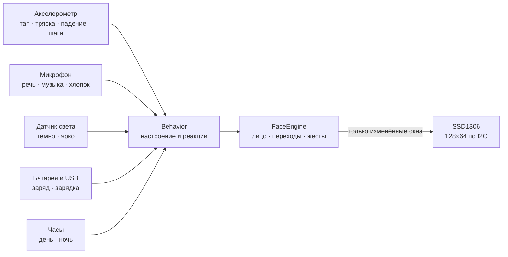

<div align="center">


# Брелок с эмоциями

**Брелок на рюкзак с белым OLED-экраном, на котором живёт персонаж.**<br>
Он моргает, оглядывается, смеётся, злится, засыпает в темноте и реагирует на тапы, тряску, звук и свет.

[](https://github.com/olerast67/emotion-keychain/actions/workflows/ci.yml)


[](LICENSE.md)

[Движок](docs/engine.md) · [Эмоции](docs/emotions.md) · [Железо](docs/hardware.md) · [Энергия](docs/power.md) · [План](docs/plan.md)

</div>

---

## Что он умеет

- **139 эмоций.** Радость, смех, грусть, злость, удивление, сон, головокружение, «слушает», «кушает» на зарядке — и мемные: орущий сойджак, Ленни, `¯\_(ツ)_/¯`, FFFUUU, $_$, переворот стола. [Весь каталог](docs/emotions.md).
- **Каждая эмоция живая.** Моргание, взгляд, подвижные зрачки и фирменный жест: дыхание, брови, прищур, наклон головы, «болтовня». Переходы плавные, смена формы глаз спрятана за морганием.
- **Характер.** Персонаж сам выбирает реакцию на ситуацию: тап, тряску, падение, хлопок, музыку, темноту, холод, зарядку, долгое одиночество. Варианты реакций чередуются, у раздражения есть лестница от «-_-» до переворота стола.
- **Экран не гаснет**, пока его кто-то может видеть, и при этом экономит батарею. Кадр рисуется только при изменении лица, на экран уходят только изменённые участки, процессор спит между кадрами.
- **Один код везде:** прошивка ESP32 и nRF52840, симуляторы на ПК и страница в браузере.

<div align="center">

</div>

## Как это работает



Подробно — в [описании движка](docs/engine.md).

## Устройство

| | |
|---|---|
| **Экран** | белый OLED 0.96″, SSD1306, 128×64 |
| **Мозг** | nRF52840, в прототипе — Seeed XIAO nRF52840 Sense |
| **Датчики** | акселерометр, PDM-микрофон, датчик света, кнопка |
| **Питание** | LiPo 250–300 мА·ч, зарядка по USB-C |
| **Автономность** | цель — 5+ дней с лицом днём и сном ночью |
| **Размер** | ≈27×33×11 мм, открытые платы на кольце, без корпуса |

Компоненты, стек плат и закупки — в [docs/hardware.md](docs/hardware.md), расчёт тока — в [docs/power.md](docs/power.md).

## Быстрый старт

Нужны CMake 3.16+ и компилятор с C++20 (GCC 10+ или Clang 12+). SDL2 нужен только для оконного симулятора.

```sh
cmake -S . -B build -DCMAKE_BUILD_TYPE=Release
cmake --build build

./build/face_tests                              # тесты движка
./build/facegen list                            # все эмоции и клипы
./build/facegen anim lenny out/lenny.gif        # эмоция в GIF
./build/facegen trans neutral laugh out/t.gif   # переход между эмоциями
./build/facegen sheet out/all.gif --scale 2     # контактный лист всех эмоций
./build/facegen bench                           # кадры и нагрузка на шину по каждой эмоции
./build/facesim                                 # окно с лицом (если есть SDL2)
```

### Симулятор в браузере

```sh
sim/web/build.sh    # нужны clang с целью wasm32 и wasm-ld (пакет lld)
```

Откройте `sim/web/dist/index.html`, сервер не нужен. На странице:

- тапы прямо по экрану;
- ситуации: тряска, падение, музыка, темнота, зарядка;
- выбор любой из 139 эмоций и жесты;
- ускорение времени;
- живые цифры: кадры в секунду и занятость шины.

### На живом экране

ESP32-C5, обычная ESP32, C3 или S3 и модуль SSD1306 на четырёх проводах. Прошивка ставится из браузера без установки или через PlatformIO:

```sh
cd firmware && pio run -e esp32c5 -t upload && pio device monitor
```

Подключение, команды и что проверить на панели — в [firmware/README.md](firmware/README.md).

## Структура

```
engine/          движок лиц: C++20 без кучи, исключений и libm
  include/face/  заголовки: параметры лица, каталог, движок, поведение
  src/           отрисовка, анимация, 139 пресетов эмоций, поведение
  tests/         тесты без внешних зависимостей
firmware/        прошивка: стенд на ESP32 сейчас, XIAO nRF52840 — следующий этап
hardware/        платы в KiCad (следующий этап)
sim/
  cli/           facegen — GIF, контактные листы, бенчмарк, каталог
  sdl/           facesim — оконный симулятор
  web/           симулятор в браузере (движок в WebAssembly)
docs/            движок, эмоции, железо, энергия, план
tools/           вспомогательные скрипты
```

## Дорожная карта

- [x] Движок лиц: 139 эмоций, переходы, жесты, поведение
- [x] Симуляторы: консольный, оконный, в браузере
- [x] Прошивка стенда: ESP32-C5 / ESP32 / C3 / S3 + SSD1306 + сенсорная кнопка
- [ ] Стенд и прототип на XIAO nRF52840 Sense с белым SSD1306
- [ ] Замеры тока и энергетика постоянного лица
- [ ] Настоящие датчики: тапы, шаги, звук, свет
- [ ] Вариант A: плата-носитель в форме брелока
- [ ] Механика открытых плат: ушко, ячейка, шлейф экрана
- [ ] Вариант B: своя плата

Этапы с критериями готовности — в [docs/plan.md](docs/plan.md).

## Как добавить эмоцию

1. Добавьте id в `FACE_EXPR_LIST` в [`engine/include/face/expressions.h`](engine/include/face/expressions.h).
2. Опишите пресет на том же месте в [`engine/src/expressions.cpp`](engine/src/expressions.cpp): глаза, брови, рот, значки, жест.
3. Проверьте: `./build/facegen anim <id> out/x.gif` и `./build/face_tests`.
4. Пересоберите каталог: `./build/facegen catalog docs/emotions.md`. CI проверяет, что он совпадает с кодом.

Идеи эмоций удобно заводить [задачей по шаблону](https://github.com/olerast67/emotion-keychain/issues/new/choose).

## Лицензия

Код открыт по [PolyForm Noncommercial 1.0.0](LICENSE.md). Собрать брелок для себя, менять код, рисовать свои эмоции и делиться ими можно бесплатно.

Продавать устройства, наборы или платы с этим кодом можно только по коммерческой лицензии: процент с продаж или разовая оплата. Условия — в [COMMERCIAL.md](COMMERCIAL.md).
