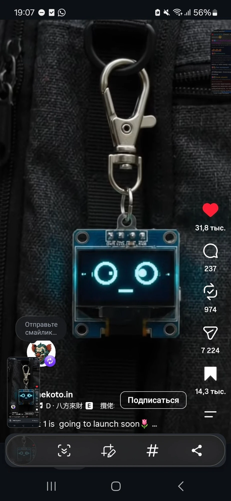
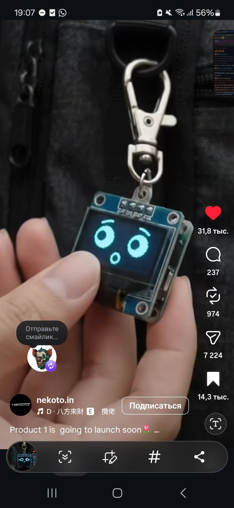
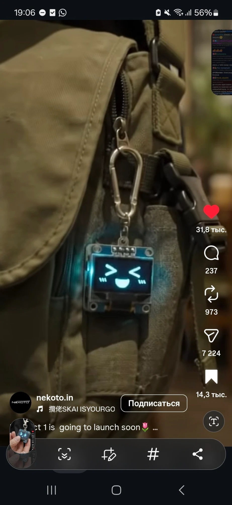
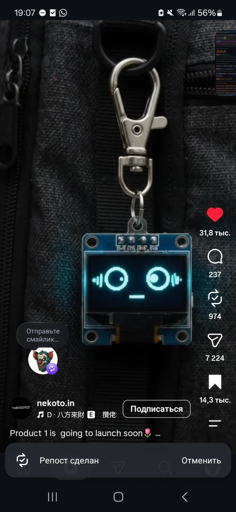

# Брелок с эмоциями

Брелок на сумку или рюкзак с маленьким OLED-экраном, на котором живёт мордочка. Она моргает, оглядывается, удивляется, смеётся и меняет выражение сама или в ответ на то, что происходит вокруг.

Референс: ролик nekoto.in «Product 1 is going to launch soon» (скриншоты ниже).

## Как выглядит

| | |
|---|---|
|  |  |
|  |  |

## Что видно на референсе

- Экран: монохромный OLED 0,96" 128×64 на синей плате с 4 пинами (GND, VCC, SCL, SDA), то есть модуль SSD1306 по I2C. Свечение голубое.
- Сзади под экраном стоит вторая плата с электроникой и, судя по толщине, аккумулятором. Сбоку видна кнопка или разъём.
- Сверху ушко под кольцо, брелок висит на карабине.
- Эмоции на скриншотах: спокойный взгляд с глазами-кольцами и ротиком-чёрточкой, удивление с бровями и ротиком «о», смех с глазами `> <` и румянцем, «слушаю» со звуковыми волнами у глаз.

## Что будем делать

Свою версию такого брелка: железо, корпус и прошивку с набором анимированных эмоций. Состав, схема и план появятся в репозитории по ходу работы.
