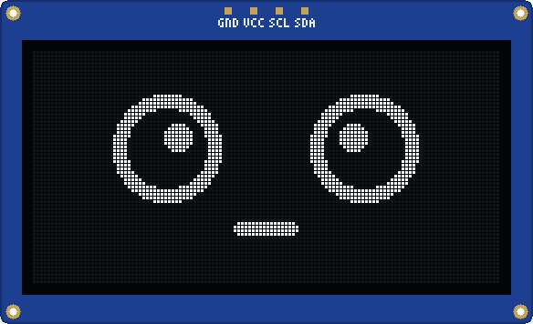
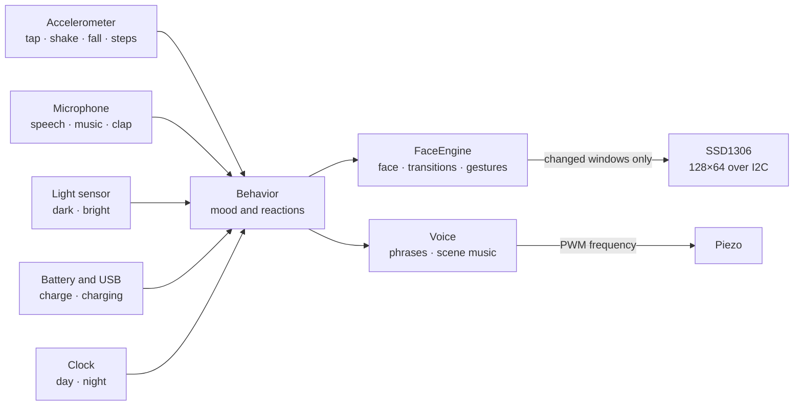
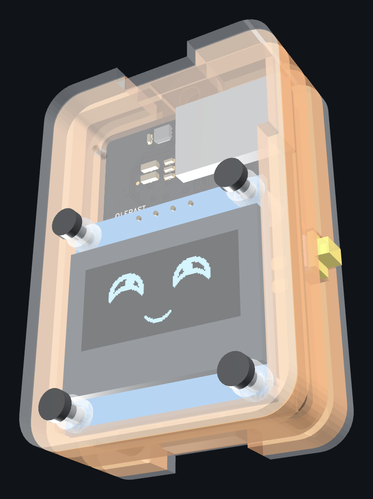
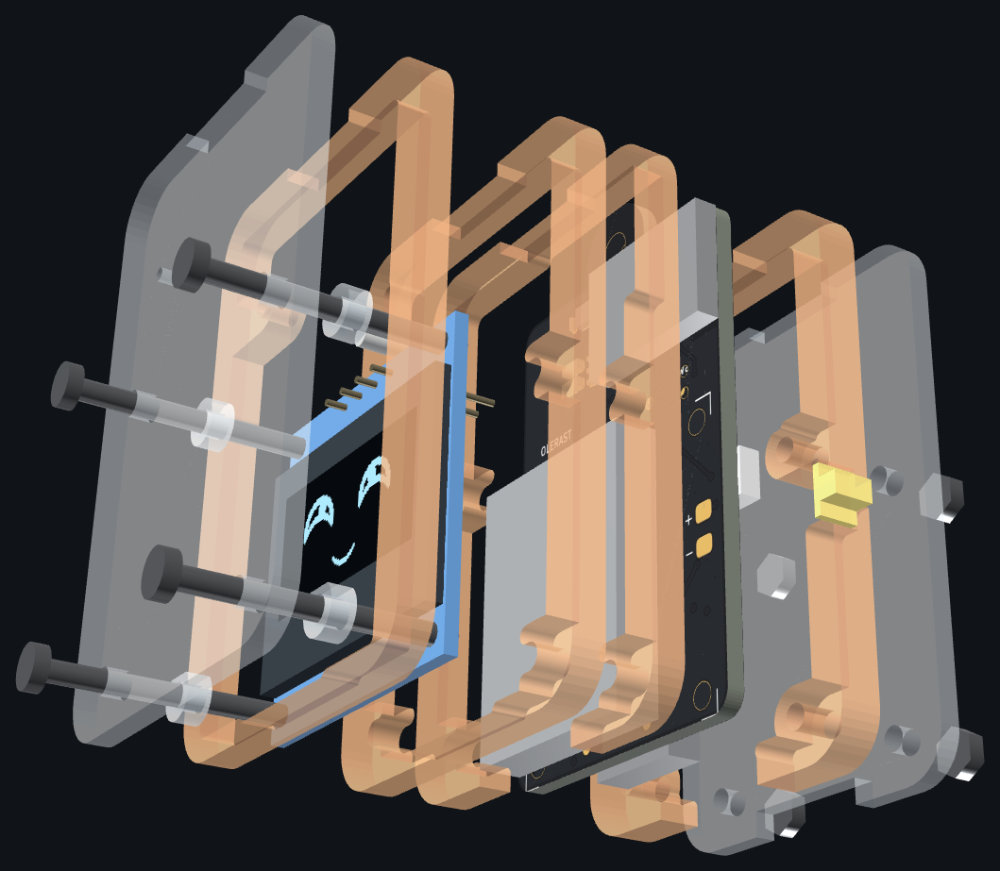

English | [Русский](README.ru.md)

<div align="center">



# Emotion keychain

**A backpack keychain with a small white OLED screen and a character living on it.**<br>
It blinks, looks around, laughs, gets angry, falls asleep in the dark and reacts to taps, shaking, sound and light.

[](https://github.com/olerast67/emotion-keychain/actions/workflows/ci.yml)


[](LICENSE)
[](hardware/LICENSE)
[](LICENSES/CC-BY-4.0.txt)

[Owner's guide](docs/user-guide.en.md) · [Engine](docs/engine.en.md) · [Emotions](docs/emotions.en.md) · [Voice](docs/sound.en.md) · [Encounters](docs/encounters.en.md) · [Hardware](docs/hardware.en.md) · [Board](hardware/rev-b/README.en.md) · [Case](hardware/rev-b/case/README.en.md) · [Power](docs/power.en.md) · [Plan](docs/plan.en.md)

</div>

---

> [!IMPORTANT]
> **Project status**
> - **Works today:** the face engine, the simulators (desktop and browser) and the **ESP32 test stand** — a cheap dev board with a real OLED screen.
> - **Designed, not built yet:** the **rev B keychain board**. It passes DRC and a full simulation of its firmware, but it has **not been fabricated or tested** on real hardware. Order it only if you are fine with being the first to try it.
> - **Battery life numbers are estimates** from a simulation of the board, not measurements.

## Three ways in

| | | |
|---|---|---|
| **Try it in the browser** | No hardware, nothing to install. Tap the face, shake it, turn off the lights, start a duel with a neighbour. | [olerast67.github.io/emotion-keychain](https://olerast67.github.io/emotion-keychain/) |
| **Build the ~$10 ESP32 version** | Any ESP32 dev board (C5, classic, C3 or S3), a 0.96″ SSD1306 module and four wires. Optional touch button and piezo. Flash it from the browser on [olerast.com](https://olerast.com/projects/emotion-keychain/flash). | [ESP32 stand](firmware/README.en.md#esp32-stand) |
| **Make the rev B keychain** | The real thing: a 30 × 46 mm nRF52840 board in an acrylic case, with sensors, a piezo voice, vibration and a Li-Po cell. Not yet tested — see the status above. | [Board](hardware/rev-b/README.en.md) · [Case](hardware/rev-b/case/README.en.md) · [Firmware](firmware/README.en.md#rev-b-board) |

## Features

- **139 emotions.** Joy, laughter, sadness, anger, surprise, sleep, dizziness, "listening", "eating" while charging — and memes: the screaming soyjak, Lenny, `¯\_(ツ)_/¯`, FFFUUU, `$_$`, the table flip. [Full catalogue](docs/emotions.en.md).
- **Every face is alive.** Blinking, gaze, moving pupils and a signature gesture each: breathing, eyebrows, squinting, head tilt, chatter. Transitions are smooth, and eye shape changes hide behind a blink.
- **Ten characters:** playful, grumpy, sleepy, shy, curious, chill, drama, glitchy, sly and kind. Each has its own resting face, its own answer to touches, its own hobbies, tempo and voice. The character and looks come from the chip's serial number, so no two keychains are the same. One in a hundred is legendary, with a golden cyber eye.
- **It reacts to the world.** Taps, shaking, falls, claps, music, darkness, cold, charging, long loneliness. Reactions rotate, and annoyance has a ladder from "-_-" to flipping the table.
- **Growth and achievements.** It starts with 44 emotions and unlocks the rest as "implants" for days together, touches, steps and encounters — about a month in all. On top: a streak of days together and 24 achievements with a trophy, from FIRST FRIEND to MARATHON and 1337.
- **Synthesized voice.** A piezo buzzer answers touches with short "words" made of notes, R2-D2 style, and every character has its own pitch and manner. Scenes have their own music, from a modem handshake during a "hack" to Happy Birthday. [How it sounds](docs/sound.en.md).
- **Encounters and duels over Bluetooth, without pairing.** Two keychains nearby find each other on their own, become friends day by day from NEW FRIEND to BFF, duel, and the older one gifts the younger an emotion. After a duel they chat in a beeping cipher. [Protocol](docs/encounters.en.md).
- **Surprises and easter eggs.** Fake hacks, hiding, reboots, ERROR 404: MOOD NOT FOUND, a ":(" blue screen, holidays and your birthday, H4X0R MODE at 13:37, and a logo bouncing until it hits the corner while charging.
- **Three themes:** classic, cyberpunk and retro (big pixels like an old handheld).
- **Kind to the battery.** A frame is drawn only when the face changes, only the changed parts go to the screen, and the CPU sleeps between frames.
- **One codebase everywhere:** the rev B firmware (nRF52840), the ESP32 stand, desktop simulators and the browser page.

<div align="center">

</div>

## How it works



Details are in the [engine description](docs/engine.en.md).

## The rev B keychain

<div align="center">

</div>

<table>
<tr>
<td width="50%"></td>
<td width="50%"></td>
</tr>
<tr>
<td align="center">Assembled: the screen behind a clear cover</td>
<td align="center">Exploded: acrylic layers, screen module and board</td>
</tr>
</table>

| | |
|---|---|
| **Screen** | white 0.96″ OLED, SSD1306, 128×64 |
| **Brain** | nRF52840: Raytac MDBT50Q module on the rev B board |
| **Sensors** | LIS3DH accelerometer, PDM microphone, LTR-303ALS light sensor, button |
| **Voice and feedback** | piezo buzzer, vibration motor |
| **Power** | protected Li-Po cell, 402025, 502025 or 602025 (150–250 mAh); USB-C charging at 100 mA, only at 10–42 °C by the nRF die temperature |
| **Board** | 30 × 46 mm plus a ring tab, 4 layers, production files for JLCPCB and PCBWay |
| **Case** | laser-cut acrylic "sandwich", 35 × 51 mm, 18.8 / 19.8 / 20.8 mm thick in three versions S, M, L for different cells |
| **Battery life (estimate)** | a typical day — about 11, 15 and 18 days (S, M, L); 16 h of face a day — about 3–5 days. **Simulation estimate, not measured** |

- **Generated from one description.** Schematic, placement, routing, Gerber, BOM and CPL are built by scripts from [`netlist.py`](hardware/rev-b/gen/netlist.py); nothing is edited by hand in KiCad.
- **Four layers,** a solid ground plane, the antenna at the edge with no copper under it.
- **Assembly:** the factory places the small parts on both sides; by hand you add the screen module, the cell and the vibration motor (about 15 minutes).
- **Ready to order:** production files are in [`hardware/rev-b/out`](hardware/rev-b/out) and [`hardware/rev-b/out/panel`](hardware/rev-b/out/panel). Remember that nobody has built one yet.

Parts, stack-up and sourcing: [docs/hardware.en.md](docs/hardware.en.md). Current budget: [docs/power.en.md](docs/power.en.md). Using the keychain: [owner's guide](docs/user-guide.en.md).

## Repository layout

```
engine/          face engine: C++20, no heap, no exceptions, no libm
  include/face/  headers: face parameters, catalogue, engine, behaviour
  src/           rendering, animation, 139 emotion presets, behaviour
  tests/         tests with no external dependencies
firmware/        firmware: rev B board (nRF52840) and the ESP32 stand
  src/keychain/  rev B: sensors, radio, power, console
  bootloader/    bootloader for the first flash over SWD
  release/       ready-made firmware files
hardware/
  rev-b/         the rev B board: KiCad, Gerber, BOM, CPL, schematic PDF
    gen/         generators: netlist.py, placement, routing, production files
    case/        acrylic case: cut files and a 3D viewer
sim/
  cli/           facegen — GIFs, contact sheets, benchmark, catalogue
  sdl/           facesim — desktop window simulator
  web/           browser simulator (the engine in WebAssembly)
docs/            engine, emotions, hardware, power, plan, owner's guide
tools/           helper scripts
LICENSES/        licence texts (see REUSE.toml)
```

## Build

You need CMake 3.16+ and a C++20 compiler (GCC 10+ or Clang 12+). SDL2 is only needed for the window simulator.

```sh
cmake -S . -B build -DCMAKE_BUILD_TYPE=Release
cmake --build build

./build/face_tests                              # engine tests
./build/facegen list                            # all emotions and clips
./build/facegen anim lenny out/lenny.gif        # one emotion as a GIF
./build/facegen trans neutral laugh out/t.gif   # a transition between two emotions
./build/facegen sheet out/all.gif --scale 2     # contact sheet of all emotions
./build/facegen scene hack out/hack.gif         # a surprise scene (--theme cyber for cyberpunk)
./build/facegen sound all out/voice.wav         # the keychain's voice as WAV (--serial N for another one)
./build/facesim                                 # window with a face (if SDL2 is present)
```

Browser simulator (needs clang with the wasm32 target and wasm-ld from lld):

```sh
sim/web/build.sh    # then open sim/web/dist/index.html, no server needed
```

Firmware (PlatformIO):

```sh
cd firmware
pio run -e esp32c5 -t upload && pio device monitor   # ESP32 stand (also esp32dev, esp32c3, esp32s3)
pio run -e keychain                                  # rev B board → .pio/build/keychain/
```

Ready-made firmware files are in [`firmware/release/`](firmware/release/README.en.md). The first flash of a rev B board goes over SWD with a Raspberry Pi Pico as the programmer, see the [bootloader notes](firmware/bootloader/README.en.md). Board and case generators (KiCad 7, Python) are described in the [board README](hardware/rev-b/README.en.md) and [hardware overview](hardware/README.en.md).

## How this was made

This project was built by a non-expert — not an electronics engineer or a professional programmer — working with an AI assistant, Claude by Anthropic. The engine, the firmware, the board generators, the case and these docs were written in conversation, then checked with tests, simulation, DRC and many review passes. That is also why the status box above is so careful: what has not been tested on real hardware is clearly marked. Bug reports and fixes from people who know better are very welcome.

## Licences

The project is fully open source. You may build, modify and sell keychains, boards and cases under these terms:

| What | Licence | File |
|---|---|---|
| Code: `engine/`, `firmware/`, `sim/`, `tools/`, CMake and scripts | Apache-2.0 | [LICENSE](LICENSE), [NOTICE](NOTICE) |
| Hardware: `hardware/` — KiCad files, generators, Gerber, BOM/CPL, case files | CERN-OHL-W-2.0 | [hardware/LICENSE](hardware/LICENSE), [text](LICENSES/CERN-OHL-W-2.0.txt) |
| Documentation and images: `docs/`, README files, `*.md`, PNG and GIF | CC-BY-4.0 | [text](LICENSES/CC-BY-4.0.txt) |

[REUSE.toml](REUSE.toml) maps every path to its licence. Firmware binaries also contain third-party code under its own licences (the Adafruit nRF52 Arduino core under LGPL-2.1, the Nordic SoftDevice S140 under Nordic's licence, and more): see [THIRD_PARTY_NOTICES.md](THIRD_PARTY_NOTICES.md).

**Trademarks.** The project name, logo, mascot and character art style and the OLERAST brand are not licensed. Forks and derivative products must use a different name; "compatible with Emotion keychain" or "based on Emotion keychain" is fine. See [TRADEMARKS.md](TRADEMARKS.md).

## Contributing

Ideas for new emotions are easiest to file with the [issue template](https://github.com/olerast67/emotion-keychain/issues/new/choose). To add an emotion yourself: add its id to `FACE_EXPR_LIST` in [`engine/include/face/expressions.h`](engine/include/face/expressions.h), describe the preset in [`engine/src/expressions.cpp`](engine/src/expressions.cpp), check it with `./build/facegen anim <id> out/x.gif` and `./build/face_tests`, and regenerate the catalogue with `./build/facegen catalog docs/emotions.md` (CI checks that it matches the code).

## Support

The project is free and open: no ads, no paid features, no accounts. Donations go into test boards, parts and the time it takes to get rev B from "designed" to "tested on real hardware".

<a href="https://boosty.to/olerast/donate"></a>
&nbsp;
<a href="DONATE.md"></a>

A star on the repository, a photo of the stand you built, or a bug report helps too.
