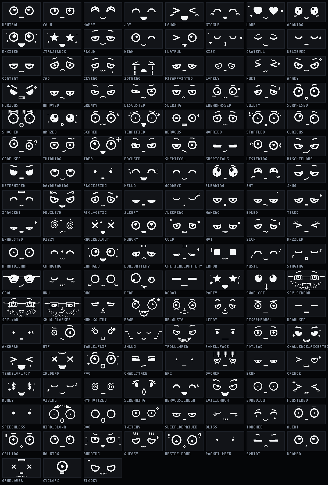

# Каталог эмоций

Файл создан командой `facegen catalog docs/emotions.md` из `engine/src/expressions.cpp`, руками не править. Всего эмоций: 139.

## Позитивные (19)

| id | Эмоция | Когда появляется | Затем |
|---|---|---|---|
| `neutral` | Спокойствие | Состояние по умолчанию: ничего особенного не происходит. | держится |
| `calm` | Умиротворение | Тихо, светло, никто не трогает уже несколько минут. | держится |
| `happy` | Радость | Приятное событие: погладили, взяли в руки, хорошее настроение. | держится |
| `joy` | Восторг | Очень хорошо: много внимания подряд, зарядился, утро после сна. | → `happy` через 5.0 с |
| `laugh` | Смех | Двойной тап, щекотка (частые лёгкие тапы), смешной звук. | → `happy` через 3.5 с |
| `giggle` | Хихиканье | Лёгкий тап в хорошем настроении; затихающий смех. | → `happy` через 2.5 с |
| `love` | Влюблённость | Долгое внимание: держат в руках, гладят, много тапов в хорошем настроении. | → `adoring` через 6.0 с |
| `adoring` | Умиление | После «влюблённости», тёплое спокойное внимание. | держится |
| `excited` | Возбуждение | Начало прогулки, бег, новое место, ждёт чего-то хорошего. | → `happy` через 4.0 с |
| `starstruck` | Восхищение | Что-то потрясающее: пасхалка, особая дата, редкое событие. | → `happy` через 4.0 с |
| `proud` | Гордость | Долго носили без падений, «рекорд» шагов, похвалили кнопкой. | → `happy` через 4.0 с |
| `wink` | Подмигивание | Приветствие, ответ на одиночный тап, случайная шалость. | → `happy` через 1.8 с |
| `playful` | Дурачится | Игривое настроение, ответ на щекотку, «бе-е». | → `happy` через 3.0 с |
| `kiss` | Поцелуй | Нежность: долго держат в ладони, вечер после хорошего дня. | → `adoring` через 2.5 с |
| `grateful` | Благодарность | Поставили на зарядку, когда был голоден; помогли после падения. | → `happy` через 2.6 с |
| `relieved` | Облегчение | Тряска закончилась, снова светло после темноты, зарядка после «голода». | → `calm` через 3.0 с |
| `content` | Довольство | Сыт (заряжен), спокойная обстановка, после приятного события. | держится |
| `bliss` | Блаженство | Спокойно держат в ладони, тёплые мягкие касания подряд. | → `content` через 6.0 с |
| `touched` | Растроганность | Взяли в руки после долгой разлуки (2+ часа одиночества). | → `happy` через 3.0 с |

## Негативные (14)

| id | Эмоция | Когда появляется | Затем |
|---|---|---|---|
| `sad` | Грусть | Давно не трогали, грубо обошлись, затихающий плач. | держится |
| `crying` | Плач | После сильного удара или долгого одиночества; когда «рыдание» стихает. | → `sad` через 6.0 с |
| `sobbing` | Рыдание | Очень больно или обидно: падение с высоты, долгая тряска, «Т_Т». | → `crying` через 4.0 с |
| `disappointed` | Разочарование | Ждал реакции (тапнул в ответ — тишина), сняли с зарядки раньше времени. | → `neutral` через 5.0 с |
| `lonely` | Одиночество | Несколько часов без движения и внимания при свете. | держится |
| `hurt` | Ой, больно | Удар, падение на пол, резкий толчок. | → `sad` через 1.8 с |
| `angry` | Злость | Долго трясли, много тапов подряд после «раздражения». | → `annoyed` через 5.0 с |
| `furious` | Ярость | Продолжают трясти или тыкать, когда уже злится. | → `angry` через 4.0 с |
| `annoyed` | Раздражение | Третий-четвёртый тап подряд, будят ночью, мешают спать. | → `neutral` через 5.0 с |
| `grumpy` | Ворчание | Разбудили раньше времени, холодное утро, плохое настроение. | держится |
| `disgusted` | Отвращение | Мокро, грязно, неприятный резкий шум, «фу». | → `neutral` через 3.0 с |
| `sulking` | Обида | Долго не обращали внимания, а потом тапнули: «не разговариваю». | → `neutral` через 6.0 с |
| `embarrassed` | Смущение | Уронили при людях, перевернули вверх ногами, громко рассмеялись рядом. | → `neutral` через 3.5 с |
| `guilty` | Вина | Разбудил ночью, разрядился «не вовремя», после ошибки. | → `neutral` через 4.0 с |

## Удивление и страх (8)

| id | Эмоция | Когда появляется | Затем |
|---|---|---|---|
| `surprised` | Удивление | Неожиданный тап, внезапный звук средней громкости, кто-то взял в руки. | → `curious` через 2.2 с |
| `shocked` | Шок | Очень громкий хлопок, сильный удар, падение с высоты. | → `scared` через 2.5 с |
| `amazed` | Изумление | Красивое: яркий свет после темноты, музыка, новое место. | → `happy` через 3.5 с |
| `scared` | Страх | Свободное падение, резкая темнота, громкий звук ночью. | → `worried` через 3.5 с |
| `terrified` | Ужас | Падение с большой высоты, очень сильная тряска. | → `scared` через 2.5 с |
| `nervous` | Нервы | Мало заряда, шумно и тесно, долго в темноте сумки. | держится |
| `worried` | Тревога | После испуга, заряд подходит к концу, что-то пошло не так. | держится |
| `startled` | Испуг | Резкий толчок или громкий звук — мгновенная реакция. | → `surprised` через 1.2 с |

## Мысли и внимание (12)

| id | Эмоция | Когда появляется | Затем |
|---|---|---|---|
| `curious` | Любопытство | Новое место, незнакомый звук, после удивления. | → `neutral` через 5.0 с |
| `confused` | Недоумение | Перевернули вверх ногами, странная последовательность тапов. | → `neutral` через 4.0 с |
| `thinking` | Раздумье | Пауза между событиями, «решает», что делать дальше. | держится |
| `idea` | Идея! | После «раздумья»; придумал игру; пасхалка. | → `happy` через 2.2 с |
| `focused` | Сосредоточенность | Внимательно слушает, «смотрит» на что-то, ровная ходьба. | держится |
| `skeptical` | Скепсис | «Да ну?» — после странного действия, повторного тапа. | → `neutral` через 4.0 с |
| `suspicious` | Подозрение | «¬_¬»: подкрадываются, тихо трогают, странный звук. | → `neutral` через 4.0 с |
| `listening` | Слушает | Рядом речь или ровный звук. | держится |
| `mischievous` | Хитрость | Задумал шалость, перед «пасхалкой», после смеха. | → `happy` через 4.0 с |
| `determined` | Решимость | Быстрая ходьба, подъём по лестнице, «вперёд!». | держится |
| `daydreaming` | Мечты | Долго спокойно, мягкий свет, вечер. | держится |
| `processing` | Загрузка | Включение, обновление прошивки, подключение к телефону. | держится |

## Общение (9)

| id | Эмоция | Когда появляется | Затем |
|---|---|---|---|
| `hello` | Привет! | Взяли в руки после перерыва, включение, утро. | → `happy` через 2.5 с |
| `goodbye` | Пока! | Выключение кнопкой, уход в сон. | → `sleepy` через 2.5 с |
| `pleading` | Ну пожалуйста | Голоден (низкий заряд), просит внимания после долгого одиночества. | держится |
| `shy` | Стеснение | Нежное внимание, комплимент (ласковые тапы), знакомство. | → `happy` через 4.0 с |
| `smug` | Самодовольство | После «победы»: дождался зарядки, угадал, пережил тряску. | → `neutral` через 4.0 с |
| `innocent` | Невинность | «Это не я»: после шалости, после того как его уронили. | → `happy` через 4.0 с |
| `devilish` | Чертёнок | Пасхалка, ночная шалость, ответ на тройной тап. | → `mischievous` через 4.0 с |
| `apologetic` | Извинение | Пропустил событие, разрядился, «прости». | → `neutral` через 3.0 с |
| `calling` | Эй! (зовёт) | Давно не обращают внимания, а брелок двигается: зовёт хозяина. | → `disappointed` через 15.0 с |

## Состояния (14)

| id | Эмоция | Когда появляется | Затем |
|---|---|---|---|
| `sleepy` | Сонливость | Вечер, полумрак, долго без движения. | держится |
| `sleeping` | Сон | Ночь, темнота, долгое бездействие (перед выключением экрана). | держится |
| `waking` | Пробуждение | Стало светло, взяли в руки, утро. | → `neutral` через 2.2 с |
| `bored` | Скука | 10+ минут ничего не происходит при свете. | держится |
| `tired` | Усталость | Долгая прогулка, много тряски, поздний вечер. | держится |
| `exhausted` | Изнеможение | Бег, очень долгая тряска, заряд почти на нуле. | держится |
| `dizzy` | Головокружение | Сильно и долго трясли, крутили. | → `tired` через 4.0 с |
| `knocked_out` | Нокаут | Падение на твёрдое, удар после свободного падения. | → `dizzy` через 3.5 с |
| `hungry` | Голод | Заряд ниже 20 %: «хочу кушать». | держится |
| `cold` | Холодно | Датчик температуры: ниже +5 °C. | держится |
| `hot` | Жарко | Датчик температуры: выше +35 °C, лежит на солнце. | держится |
| `sick` | Недомогание | Перегрев, сбой датчика, долгая тряска в транспорте. | держится |
| `dazzled` | Ослеплён | Резко стало очень ярко: вынули из сумки на солнце. | → `neutral` через 2.0 с |
| `afraid_dark` | Боится темноты | Внезапно стало темно (положили в сумку) — перед засыпанием. | → `sleepy` через 3.0 с |

## Система (5)

| id | Эмоция | Когда появляется | Затем |
|---|---|---|---|
| `charging` | Зарядка | Подключили USB: «кушает». | держится |
| `charged` | Заряжен | Зарядка завершена. | → `content` через 3.0 с |
| `low_battery` | Мало заряда | Заряд ниже 10 %. | держится |
| `critical_battery` | Почти разряжен | Заряд ниже 3 %: сохранить состояние и уснуть. | держится |
| `error` | Сбой | Ошибка датчика или экрана, неудачное обновление. | → `confused` через 3.0 с |

## Веселье (11)

| id | Эмоция | Когда появляется | Затем |
|---|---|---|---|
| `music` | Музыка | Микрофон слышит ритм: качается в такт. | держится |
| `singing` | Поёт | Хорошее настроение и тишина: напевает сам себе. | → `happy` через 5.0 с |
| `cool` | Крутой | Яркое солнце, быстрая езда, пасхалка. | → `smug` через 5.0 с |
| `uwu` | UwU | Нежные поглаживания, милота. | → `adoring` через 4.0 с |
| `owo` | OwO | «Что тут у нас?» — интерес плюс милота. | → `curious` через 4.0 с |
| `derp` | Глупая рожица | После головокружения, редкая шутка. | → `giggle` через 3.5 с |
| `robot` | Робот | Пасхалка: «режим робота», сканирует окрестности. | → `neutral` через 5.0 с |
| `party` | Праздник | День рождения, Новый год, особая дата. | → `happy` через 6.0 с |
| `game_over` | GAME OVER | Третье падение за 10 минут или очень сильный удар. | → `waking` через 3.5 с |
| `cyclops` | Циклоп | Редкая пасхалка в хорошем настроении (не чаще раза в 2 часа). | → `neutral` через 3.0 с |
| `spooky` | Хэллоуин | 31 октября, полночь, ночные пасхалки. | → `mischievous` через 5.0 с |

## Мемы (39)

| id | Эмоция | Когда появляется | Затем |
|---|---|---|---|
| `swab_cat` | Кот с ватной палочкой | Пасхалка: уставился не моргая, во рту палочка. | → `zoned_out` через 6.0 с |
| `soy_scream` | Ору (сойджак) | «ВАУ!!!»: громкий звук, внезапная музыка, редкая пасхалка. | → `soy_wow` через 3.5 с |
| `soy_wow` | Восторг сойджака | Восхищение «как в рекламе консоли»: музыка, новое место. | → `excited` через 4.0 с |
| `smug_glasses` | Ну-ну (вояк в очках) | Снисходительная ухмылка: «я так и знал». | → `smug` через 5.0 с |
| `hmm_squint` | Хмм… | Сомнение с прищуром: «ну такое…». | → `skeptical` через 4.5 с |
| `rage` | FFFUUU | Последняя капля: трясут, когда он уже в ярости. | → `furious` через 3.5 с |
| `me_gusta` | Ме густа | Неожиданно приятно: тёплая ладонь, любимая музыка. | → `content` через 5.0 с |
| `lenny` | Ленни ( ͡° ͜ʖ ͡°) | Хитрый намёк, пасхалка, «ну ты понял». | → `smug` через 5.0 с |
| `disapproval` | Неодобрение ಠ_ಠ | Разбудили, уронили, тыкают без повода. | → `annoyed` через 5.0 с |
| `unamused` | Ну и ну -_- | Третий тап подряд, скучная ситуация, «серьёзно?». | → `bored` через 5.0 с |
| `awkward` | Неловко •_• | Неловкая пауза, непонятный одиночный тап. | → `neutral` через 4.0 с |
| `wtf` | Чего? o_O | «Что это было?!» — странный звук, резкое движение. | → `confused` через 4.0 с |
| `table_flip` | Переворот стола | «Всё, хватит!» — после ярости, когда снова трясут. | → `angry` через 2.5 с |
| `shrug` | Пожимает плечами | «Не знаю» — непонятное событие, спросили, а ответа нет. | → `neutral` через 3.5 с |
| `troll_grin` | Тролль-ухмылка | После удачной шалости, редкая пасхалка. | → `mischievous` через 4.0 с |
| `poker_face` | Покерфейс | Делает вид, что ничего не случилось: после падения или шалости. | → `neutral` через 5.0 с |
| `not_bad` | Неплохо | Оценил: быстро зарядили, хорошая прогулка, приятная музыка. | → `happy` через 3.5 с |
| `challenge_accepted` | Вызов принят | Начало пробежки, подъём в гору, «давай!». | → `determined` через 3.5 с |
| `tears_of_joy` | Слёзы от смеха | Очень смешно: серия тапов в хорошем настроении. | → `giggle` через 3.5 с |
| `im_dead` | Умер со смеху | Смешнее некуда: «я умер». | → `tears_of_joy` через 3.5 с |
| `pog` | Пог! | Что-то крутое: зарядился до 100 %, пасхалка. | → `excited` через 2.5 с |
| `chad_stare` | Сигма-взгляд | Уверенность: быстрая ходьба, яркое солнце. | → `determined` через 5.0 с |
| `npc` | NPC | Режим «фоновый персонаж»: давно ничего не происходит. | → `neutral` через 6.0 с |
| `doomer` | Думер | Поздняя ночь, долго в темноте, заряд на исходе. | держится |
| `bruh` | Брух | Странное действие: перевернули, потрясли без причины. | → `unamused` через 4.0 с |
| `cringe` | Кринж | Неловкость: уронили при людях, громкий звук в тишине. | → `embarrassed` через 3.0 с |
| `money` | \$_\$ | Пасхалка «богатство»: зарядился до 100 %. | → `happy` через 3.0 с |
| `vibing` | На вайбе | Музыка рядом и хорошее настроение. | держится |
| `hypnotized` | Загипнотизирован | Долго крутили, мигающий свет. | → `dizzy` через 5.0 с |
| `screaming` | Крик | Жуткий звук, падение, «А-А-А!». | → `scared` через 2.5 с |
| `nervous_laugh` | Нервный смешок | Неловко, но смешно: уронили и сразу подняли. | → `nervous` через 3.0 с |
| `evil_laugh` | Злодейский смех | Пасхалка, ночная шалость: «мва-ха-ха». | → `devilish` через 3.5 с |
| `zoned_out` | Залип | Долго смотрит в одну точку, монотонная поездка. | → `neutral` через 8.0 с |
| `flustered` | Засмущался | Слишком много нежностей подряд. | → `shy` через 3.0 с |
| `speechless` | Нет слов | Нечего сказать: странное или слишком громкое событие. | → `neutral` через 4.0 с |
| `mind_blown` | Мозг взорван | Невероятно: пасхалка, особая дата. | → `amazed` через 3.0 с |
| `boo` | Бу! | Пасхалка: пугает ночью, «бу!». | → `playful` через 3.0 с |
| `twitchy` | Глаз дёргается | На грани: раздражение копится, но ещё держится. | → `annoyed` через 5.0 с |
| `sleep_deprived` | Не выспался | Разбудили ночью, мало сна, утро после бессонной ночи. | держится |

## Реакции на датчики (8)

| id | Эмоция | Когда появляется | Затем |
|---|---|---|---|
| `alert` | Настороженность | Новый звук, сумку кто-то взял, первые секунды тряски в транспорте. | → `curious` через 4.0 с |
| `walking` | Прогулка | Шагомер видит ходьбу: покачивается в такт шагам. | держится |
| `running` | Бег | Бег или подъём по лестнице. | держится |
| `queasy` | Укачало | Тряский транспорт без шагов дольше пары минут. | держится |
| `upside_down` | Вверх ногами | Брелок перевернули или он повис вверх ногами. | → `playful` через 2.0 с |
| `pocket_peek` | Кто выключил свет? | Резко стало темно: карман, сумка. | → `sleeping` через 6.0 с |
| `squint` | Щурится на свет | Достали из кармана на свет: глаза привыкают. | → `hello` через 1.4 с |
| `booped` | Тык! | Одиночный тап: короткое «ой» с отскоком глаз. | → `neutral` через 0.7 с |
