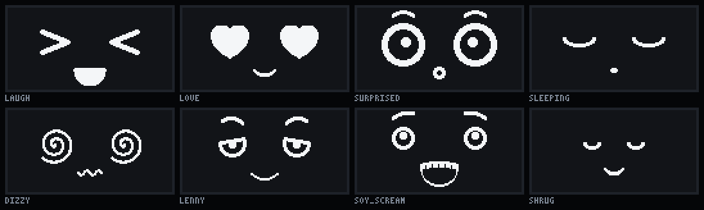

# Движок лиц

Движок рисует лицо брелока на монохромном экране 128×64 (SSD1306) и решает, какую эмоцию показать. Код лежит в `engine/`: C++20 без исключений, RTTI, кучи и libm. Поэтому один и тот же код собирается в прошивку nRF52840, в симуляторы на ПК и в WebAssembly для веб-страницы.



## Из чего состоит

| Файл | Что делает |
|---|---|
| `framebuffer.h/.cpp` | Кадровый буфер 1 КБ в родном формате SSD1306. Поиск изменённых окон страниц: на экран уходят только они |
| `raster.h/.cpp` | Примитивы: скруглённый прямоугольник, эллипс и кольцо, толстые линии, дуги, кривые Безье, многоугольники, звезда, сердце |
| `params.h` | Параметры лица: глаза, веки, брови, рот, раскладка, плюс конструкторы для пресетов |
| `expressions.h/.cpp` | Каталог эмоций (139 пресетов), значки-оверлеи, движения, фирменные жесты |
| `render_face.cpp` | Отрисовка глаз (кольцо, заливка, ∩, ∪, `> <`, сердце, звезда, искра, спираль, крестик, `$`), бровей и 12 видов рта |
| `render_overlays.cpp` | 38 значков: румянец, капли, Zzz, ноты, «?», очки, щетина, ватная палочка, летучая мышь и другие |
| `engine.h/.cpp` | `FaceEngine`: переходы, моргание, взгляд, движения, жесты, клипы, дрейф против выгорания, расписание кадров |
| `clock.h` | Время: моменты сравниваются через знаковую разность (`time_reached`), сон не дальше минуты |
| `behavior.h/.cpp` | `Behavior`: события датчиков превращаются в эмоции, плюс настроение, суточный ритм, фоновые занятия, сюрпризы, праздники и встречи |
| `identity.h/.cpp` | Характер брелока из серийного номера чипа: архетип, черты, особенности внешности, редкость |
| `progress.h/.cpp` | Рост: опыт, импланты и открытые эмоции. Запись для флеша постоянного размера с контрольной суммой: открытое сверх имплантов хранится по ключу имени эмоции, старая версия записи переносится |
| `scenes.h/.cpp` | 20 полноэкранных сцен (`FACE_SCENE_LIST`): загрузка, взлом, дождь данных, ERROR 404, перезагрузка, прятки, апгрейд, Новый год, день рождения, Хэллоуин, встреча, дуэль, секретный разговор, достижение, зарядка, выключение, баннер, синий экран, визор, заставка |
| `text.h/.cpp` | Надписи шрифтом 3×5 с клетками 2×2: латиница, цифры, знаки |

## Как пользоваться в прошивке

```cpp
#include "face/behavior.h"

face::FaceEngine engine;
face::Behavior character;

void setup() {
  engine.init(seed, millis());
  character.init(&engine, seed, millis());
}

void on_imu_double_tap() { character.on_event(face::Event::double_tap, millis()); }

void loop() {
  const uint32_t now = millis();
  if (face::time_reached(now, character.next_update_ms())) character.update(now);
  if (face::time_reached(now, engine.next_update_ms()) && engine.update(now)) {
    face::DirtyWindow w[face::kPages];
    int n = engine.dirty(w);
    for (int i = 0; i < n; ++i) ssd1306_send_window(w[i], engine.frame());  // 0x21/0x22 + байты окна
  }
  sleep_until_soonest(engine.next_update_ms(), character.next_update_ms());
}
```

Если лицо статично, `next_update_ms()` показывает на следующее запланированное событие: моргание, взгляд, жест или шаг дрейфа. До этого момента процессор спит, а экран сам держит картинку из своей памяти.

Дальше минуты (`kMaxSleepMs`) движок и поведение не планируют. `millis()` переполняется раз в 49.7 суток, поэтому моменты сравниваются только через `time_reached` из `face/clock.h`: так расписание переживает переполнение, а «никогда» не нужно выражать числом.

## Как устроена эмоция

Эмоция — это пресет в `engine/src/expressions.cpp`:

```cpp
{.id = "lenny",
 .name = "Ленни ( ͡° ͜ʖ ͡°)",
 .cat = Category::Meme,
 .eyes = both(ring(22, 3).pupil(0, 1, 3).lid(0.35f, -10)),  // кольца Ø22, зрачок, полуприкрытые веки
 .brows = brows(brow(16, -6, 3).at(0, 4)),                    // брови-дуги
 .mouth = smile(20, 4, 2),                                    // ухмылка
 .lay = layout(50, 26, 50),                                   // глаза ближе друг к другу
 .overlays = ov(O::Nose),                                     // нос «ʖ»
 .accent = Accent::Brows,                                     // фирменный жест: играет бровями
 .accent_ms = 2400,                                           // примерно раз в 2.4 с
 .hold_ms = 5000,                                             // через 5 с
 .next = Expr::smug,                                          // переходит в «самодовольство»
 .when = "Хитрый намёк, пасхалка, «ну ты понял»."},
```

- **Глаз.** Форма плюс параметры: размер, радиус, толщина обводки, зрачок или блики, верхнее веко (доля, угол, изгиб), нижнее веко, смещение, масштаб. Всё, что зависит от стороны, задаётся «к носу положительно», поэтому правый глаз зеркален левому сам собой.
- **Брови:** длина, угол (+ поднят внутренний конец), изгиб, толщина, зазор над глазом.
- **Рот:** линия или улыбка, которая плавно раскрывается в «D», «o», волна, «ω», «3», оскал, язык, крик, открытый рот-контур с зубами, зубастая ухмылка, «□».
- **Значки** — битовая маска из 38 оверлеев, у каждого своя анимация.
- **Движение** — непрерывное: подпрыгивание, дрожь, покачивание, пульс сердечек.
- **Фирменный жест** — короткое движение раз в несколько секунд: дыхание, брови, «болтовня», прищур, наклон, косой взгляд, подёргивание глаза. Благодаря жестам ни одна эмоция не стоит мёртво, а кадры нужны только во время жеста.
- **`hold_ms` и `next`** — сколько держится эмоция и во что переходит. Реакции заканчиваются сами, даже без модуля поведения.

### Добавить эмоцию

1. Допишите id в `FACE_EXPR_LIST` (`engine/include/face/expressions.h`).
2. Добавьте пресет в `kExpressions` на то же место списка. Если порядок не совпадёт, `static_assert` и тест это поймают.
3. Посмотрите результат: `facegen still my_emotion out.gif --scale 6` и `facegen anim my_emotion out.gif`.
4. Пересоберите каталог: `facegen catalog docs/emotions.md`.

## Переходы и «живость»

- **Одинаковые формы глаз и рта** (кольцо → кольцо, улыбка → открытый рот) плавно интерполируются за 150–500 мс с ease-in-out.
- **Смена формы** (кольцо → `> <`, сердце, спираль) прячется за морганием: глаз закрывается, на закрытом кадре форма подменяется, глаз открывается. Рот при смене вида сжимается и разжимается.
- **Моргание** длится около 180 мс, со сжатием и растяжением. Паузы 2.5–6.5 с (у разных эмоций свои), иногда двойное.
- **Взгляд** — саккады за 50–100 мс с кадром сжатия. Глаза, зрачки и рот сдвигаются на разные расстояния, глаз на стороне взгляда немного больше.
- **Зрачок** не прячется под веком целиком: выглядывает из-под него.
- **Дрейф** — всё лицо сдвигается на 1 px раз в 20–40 с в пределах ±3 px, чтобы OLED не выгорал.

## Экономия энергии

- **Кадр отрисовывается только когда лицо меняется.** Хэш всех параметров совпал — отрисовка пропускается целиком.
- **Кадр нужен ровно тогда, когда картинка сменится.** Движение пресета сдвигает лицо целыми пикселями, и движок просыпается в момент следующего сдвига. Шаг медленного движения (покачивание во сне) ждёт до 200 мс и уходит вместе с уже запланированным кадром.
- **У каждого значка свои часы.** Мигающие (многоточие, батарейка, звуковые волны, лампочка) будят процессор только на сменах картинки, плавные — примерно на пиксель сдвига: Zzz 5 раз в секунду, даже если рядом идёт быстрая анимация. «!» замирает, когда встряска кончилась. Время значка не растёт дальше его цикла анимации, поэтому через неделю на одной эмоции всё движется так же, как в первую минуту.
- **Пробуждения рядом сливаются:** события ближе 20 мс друг к другу обрабатываются за одно пробуждение.
- **Спокойное лицо.** Через 3 минуты без внимания (`EngineOptions::calm_after_ms`; внимание — события датчиков, кнопка, команды) фирменные жесты идут втрое реже, а взгляд — вдвое. Нейтральное лицо — около 3 кадров в секунду вместо 5.
- **На экран уходят только изменённые окна страниц.** Нейтральное лицо — около 1.2 КБ/с по I2C, это примерно 3 % шины на 400 кГц; успокоившись — около 0.8 КБ/с.
- **Долгие состояния сделаны дешёвыми:** сон, усталость, мало заряда. Дрожь от холода идёт приступами, 1 с из 4, и между приступами процессор спит.
- **Яркость по обстановке.** `Behavior::brightness()` — обычная, приглушённая ночью и во сне, минимальная в темноте и в кармане. Прошивка переводит уровень в контраст.
- **Часы могут быть неизвестны.** `set_clock(минуты)` — минуты текущих суток, `set_clock_known(false)` говорит, что настоящего времени нет (у брелока после выключения кнопкой часы потеряны). Тогда минуты — только счёт суток для лимита кормления, а всё «по часам» выключено: ночь (приглушённый экран, тихий голос, сон без дела, усталость втрое быстрее), недосып, вечернее довольство, пасхалки по времени и достижения NIGHT OWL и EARLY BIRD. Темноту брелок и без часов видит по датчику света. По умолчанию часы известны.

Нагрузку по каждой эмоции показывает `facegen bench`: время кадра, кадры в секунду, байты в секунду, занятость шины.

## Поведение

`Behavior` переводит события в эмоции по таблице ситуаций:

| Событие | Реакция (пул вариантов) |
|---|---|
| Тап | «Тык!», подмигивание, любопытство, OwO, неловко •_•, o_O |
| Два тапа | Смех, радость, озорство, хихиканье, слёзы от смеха, воздушный поцелуй — так без характера. На брелоке характер есть всегда, и двойной тап берёт его ответ (`dtap`, см. «Свой характер») |
| Три тапа | Озорство, хихиканье, слёзы от смеха, «умер со смеху», тролль |
| 4–5 тапов подряд | Раздражение, -_-, брух, скепсис, отвращение |
| 6–8 тапов | Злость, дёргается глаз, ಠ_ಠ |
| 9+ тапов за 3 с | Ярость, FFFUUU, переворот стола |
| Тап в первые 3 минуты после вспышки (6+ тапов), когда злость прошла | Неловко: извиняется, виноват, смущён |
| Взяли в руки | Радость, любопытство, настороженность, подозрение; в хорошем настроении — поцелуй, UwU |
| Встряхнули | Удивление и «отряхнулся»; сильнее — головокружение, гипноз, крик; ещё сильнее — укачало |
| Падение и удар | Ужас, затем нокаут; второй раз — плач или рыдания; третий за 10 минут — GAME OVER |
| Громкий звук | Испуг, o_O, сойджак орёт, «мозг взорван»; повторно — раздражение, отвращение |
| Речь, музыка | «Слушает», настороженность; музыка — на вайбе, танцует, поёт |
| Темно, свет | «Кто выключил свет?», затем сон; свет после темноты — щурится, затем привет |
| Идём, бежим | «Пошли гулять» (после перерыва больше 2 минут), шагает; бежит, «вызов принят», решителен; бег дольше 5 минут — выдохся. Остановился — через 2.5 с без шагов снова обычное лицо |
| Зарядка | Благодарность, если был голоден; «кушает»; полный заряд — заряжен, пог, `$_$`; отключили недозаряженным — расстроен |
| Ночь (только по заданным часам) | Во втором часу ночи и позже с ним возятся — недосып; без дела засыпает. На ходу (шагает или бежит) не засыпает |
| Долго один | Скука, «эй!» (если брелок двигается), одиночество, обида; вернулись — растроганность |
| Встречи и дуэли | Приветствие по паре характеров, звёзды в глазах при легендарном соседе; после дуэли — гордость, самодовольство, звёзды или обида, ворчание, рыдания |

Недавние реакции выпадают реже, чтобы персонаж не повторялся. Цепочки эмоций движка (смех → радость) доигрывают: характер не перебивает продолжение, но уступает цепочкам не дольше 20 с после своего выбора. Когда ничего не происходит, он сам занимается чем-нибудь раз в 12–40 секунд: осматривается, зевает, вздыхает, напевает, задумывается, сосредотачивается, нервничает. Мемные эмоции выпадают редко, как приправа: UwU и «умер со смеху» — в хорошем настроении, думер — от скуки или грусти. Циклоп — не чаще раза в 2 часа.

Каждую эмоцию каталога характер показывает и сам, без сцен наград: тест `test_emotion_reachability` проживает с каждым характером день по сценарию и проверяет это. Только после сцен нарочно бывают три: гордость и звёзды в глазах — после победы в дуэли, достижения или встречи с легендой, призрак — на Хэллоуин и в пятницу 13-е.

## Свой характер

`make_identity(serial)` превращает серийный номер чипа в персонажа. Один номер — всегда один и тот же персонаж, хранить ничего не нужно.

- **Характер** — один из десяти архетипов со своим темпераментом (`temperament.h`). Он меняет не проценты, а поведение:
  - лицо в покое, в радости и в скуке;
  - ответ на касание и двойное касание;
  - занятия от скуки;
  - темп переходов, моргание, тягу к мемам;
  - любимый сюрприз;
  - голос пищалки: основную ноту, манеру и разговорчивость ([голос брелока](sound.md)).

  Свои эмоции характер показывает с первого дня, даже если их имплант ещё не стоит.

  | Характер | В покое | Рад | Скучает | На касание | Особенность |
  |---|---|---|---|---|---|
  | игрун `PLAYFUL` | happy | joy | playful | хихикает, подмигивает | самый активный, резкие переходы |
  | ворчун `GRUMPY` | unamused | smug | poker_face | закатывает глаза | улыбку надо заслужить |
  | соня `SLEEPY` | tired | bliss | sleepy | просыпается | медленный, моргает реже, устаёт раньше |
  | скромник `SHY` | shy | content | lonely | смущается, краснеет | прячется |
  | любопытный `CURIOUS` | curious | excited | thinking | «о?», «идея!» | всё время смотрит по сторонам |
  | пофигист `CHILL` | calm | vibing | zoned_out | «круто» | плавный и неторопливый |
  | драма `DRAMA` | neutral | tears_of_joy | pleading | ахает, растроган | всё через край, самые быстрые переходы |
  | глюк `GLITCH` | robot | owo | processing | ERROR, «обработка» | мелкие сбои картинки в любой теме |
  | хитрец `TRICKSTER` | smug | mischievous | lenny | дьявольская ухмылка | больше всех мемов |
  | добряк `SWEET` | content | adoring | daydreaming | сердечки | любит всех |

  Характер считается по хэшу брелока, поэтому сосед узнаёт его по рекламному пакету BLE (`identity_from_hash`). Встреча зависит от пары: на экране встречи под позывным появляется характер соседа или `TWIN!`, если такой же. Дальше реакция по характеру: скромник смущается, добряк влюбляется, ворчун закатывает глаза при виде игруна, игрун дразнит ворчуна, два глюка устраивают дождь данных.
- **Внешность** (`Quirks`):
  - посадка глаз ±2 px;
  - размер глаз ±5 %;
  - размер зрачков;
  - частота моргания;
  - высота бровей.

  Два брелока с одной эмоцией выглядят чуть по-разному.
- **Редкость:**
  - ~10 % брелоков редкие: заметно большие зрачки или широкая посадка глаз;
  - ~1 % — легендарные, с кибер-глазом: квадратный правый зрачок и вспышка раз в 5 секунд, а когда брелок «сканирует» — риски вокруг глаза.
- **Позывной** вида `K7-3F2A`: для экрана и встреч с другими брелоками.

`facegen id <номер>` показывает, кто получится из номера.

## Рост и импланты

Новый брелок знает 44 базовые эмоции, остальные 95 приходят 11 имплантами за опыт:

| Имплант | Опыт | Что открывает |
|---|---|---|
| EMPATHY.MOD — модуль эмпатии | 150 | хихиканье, обожание, благодарность, смущение, вина… |
| REFLEX.SYS — рефлексы | 350 | восторг, шок, изумление, ужас, нервы, тревога |
| SOCIAL.LIB — общение | 600 | поцелуй, озорство, гордость, «ну пожалуйста», идея |
| MEME.DRV — мем-драйвер | 900 | ¯\_(ツ)_/¯, покерфейс, NPC, брух, Ленни |
| DRAMA.EXE — драма | 1250 | рыдания, ярость, отвращение, нокаут |
| SARCASM.DLL — сарказм | 1650 | самодовольство, ಠ_ಠ, кринж, чед, WTF |
| MEME.DRV2 — мем-драйвер 2 | 2100 | «хмм», ме густа, кот с палочкой, сойджаки, думер |
| PARTY.PKG — вечеринка | 2600 | вечеринка, песни, вайб, очки, UwU, `$_$` |
| GLITCH.CORE — глитч-ядро | 3150 | робот, дерп, гипноз, недосып, тошнота |
| CHAOS.BIN — хаос | 3750 | FFFUUU, переворот стола, тролль, злой смех, «мозг взорван» |
| GHOST.SHELL — призрак в оболочке | 4400 | призрак, «бу», «я умер», GAME OVER, циклоп |

Опыт дают:
- **день вместе** — 60;
- **касание** — 2, до 40 за день;
- **шаги** — 1 за 100 шагов, до 50 за день;
- **новый знакомый брелок** — 40, старый — 10;
- **дуэль** — 25 за победу, 10 за поражение;
- **зарядили голодного** (при малом заряде) — 15, раз в день;
- **достижения** — 20–100 за каждое, см. ниже;
- **дружба крепнет** — 15 × уровень дружбы.

При активной носке всё открывается примерно за месяц. Касания и шаги ограничены за день, чтобы брелок рос от времени вместе, а не от тряски. Победа в дуэли досрочно открывает одну эмоцию из следующего импланта.

Эмоция открыта, если её имплант установлен или она в списке дополнительных. Туда попадают выигранные в дуэлях и подаренные старшими брелоками, до 16 штук. Список хранится по ключу имени эмоции (FNV-1a от id), а не по номеру в каталоге, поэтому новые эмоции и перестановки в каталоге не сбивают записанный прогресс. Установленный имплант освобождает в списке место. Запись `Progress` постоянного размера (128 байт) с запасом под будущие поля. `Progress::load` читает записи версий 1 и 2, переводя их в текущую, третью.

`Behavior` с подключённым прогрессом (`attach_progress`) показывает только открытые эмоции. Закрытая подменяется ближайшей открытой (`furious` → `angry`), в том числе в цепочках вроде «смех → радость». Установка импланта — сцена `upgrade`, после неё персонаж показывает одну из новых эмоций с мигающей надписью NEW в углу (`FaceEngine::badge`). Так же отмечается эмоция, выигранная в дуэли или подаренная.

### Серия и достижения

**Серия** — сколько дней подряд хозяин был рядом, то есть хоть раз коснулся брелока. День без касаний обнуляет серию, рекорд остаётся.

**Достижения** открываются один раз: сцена `achievement` с кубком и названием, затем опыт. Их 24:

| Достижение | За что |
|---|---|
| FIRST FRIEND, 10 FRIENDS | первый и десятый знакомый брелок |
| FIRST WIN, 10 WINS | первая и десятая победа в дуэлях |
| NEVER GIVE UP | пять поражений — и всё равно в бой |
| 100 TAPS, 1000 TAPS | касания |
| 10K STEPS, MARATHON | 10 000 и 55 000 шагов вместе |
| 3, 7 и 30 DAY STREAK | серия дней с хозяином |
| DAY 100 | сто дней вместе |
| FULL UPGRADE | установлены все импланты |
| 5 SECRETS | пять секретных разговоров |
| CARING HUMAN | пять раз зарядили голодного |
| SURVIVOR | пережил десять падений |
| TWIN FOUND | встретил брелок того же характера |
| LEGEND MET | встретил легендарный брелок |
| NIGHT OWL, EARLY BIRD | с ним играли в 3 часа ночи и в 5 утра |
| KNOCK KNOCK | секретный стук (на плате rev B пока не открыть) |
| 1337 | был на связи в 13:37 |
| BEST FRIENDS | дружба с одним брелоком до уровня BEST FRIENDS |

Список с описаниями — `achievement(Ach)` в `progress.h`, на стенде — команда `ach`.

## Сцены и сюрпризы

`FaceEngine::play_scene` на несколько секунд показывает сцену вместо лица. Лицо продолжает жить под ней, а сцена сама заканчивается.

- **Сюрпризы** запускает поведение раз в 1–2,5 дня бодрствования, кроме экорежима:
  - взлом с бегущим кодом и ACCESS GRANTED;
  - дождь данных;
  - ERROR 404: MOOD NOT FOUND;
  - перезагрузка, когда кадр гаснет как кинескоп;
  - прятки, когда персонаж уезжает вниз и выглядывает;
  - синий экран: «:( YOUR KEYCHAIN CRASHED» и проценты до 100;
  - визор: огонёк сканера бегает туда-обратно, как у Сайлонов и KITT.

  После сюрприза — подходящая эмоция: тролль после взлома, гипноз после дождя данных, головокружение после синего экрана. У каждого характера любимый сюрприз выпадает втрое чаще.
- **Праздники и пасхалки по дате** — один раз за дату, когда персонаж бодрствует:

  | Дата | Что на экране |
  |---|---|
  | 31 декабря и 1 января | ёлка и HAPPY NEW YEAR |
  | 14 февраля | LOVE DAY <3 |
  | 29 февраля | FEB 29 — BONUS DAY |
  | 14 марта | PI DAY 3.14159265 |
  | 1 апреля | синий экран, а потом GOTCHA! |
  | 12 апреля | POEKHALI! с ракетой |
  | 4 мая | MAY THE 4TH — BE WITH YOU |
  | 25 мая | DONT PANIC — TOWEL DAY 42 |
  | 256-й день года | HELLO WORLD — DAY 256 |
  | пятница, 13-е | FRIDAY 13 — BE CAREFUL, череп |
  | 31 октября | тыква |
  | день рождения хозяина (`set_birthday`) | торт; важнее любого праздника в тот же день |
- **Пасхалки по времени** — раз в сутки на каждое время (сутки начинаются в полночь), только по заданным часам: без них (`set_clock_known(false)`) «13:37» и «3 AM» показывались бы когда попало:
  - 13:37 — «1337 H4X0R MODE» и достижение;
  - 11:11 — MAKE A WISH со звездой;
  - 12:34 — «1 2 3 4!»;
  - 03:00, если не спит, — GO TO SLEEP;
  - 04:04 — ERROR 404: TIME NOT FOUND.
- **Секретный стук.** Ритм «Shave and a haircut» пятью тапами: четверть, две восьмые, две четверти, с допуском ±35 %. Брелок отвечает пищалкой «two bits» и подмигивает. Нужны одиночные тапы: стенд выстукивает ритм командой `knock`, в симуляторе можно стучать по экрану. На плате rev B стук пока не срабатывает: прошивка ждёт 0.5 с, не будет ли касание двойным, касания внутри этого окна пропускает, а «тук-тук» датчик сам сливает в двойной тап (`poll_motion` в `firmware/src/keychain/main.cpp`). Поэтому на брелоке открываются 23 достижения из 24 ([план](plan.md)).
- **Заставка на зарядке.** Если брелок на зарядке и десять минут никто его не трогает, логотип OLERAST отскакивает от краёв, как старая заставка DVD. Пути подобраны так, что через 10 секунд он попадает точно в угол: CORNER!
- **Загрузка «OLERAST LINK»** — при включении.

Все сцены держат то же безопасное поле и минимальную толщину линий, что и эмоции. Это проверяет тест.

## Питание

- **Зарядка.** Подключили зарядку — сцена `charge`: батарея наливается до своего процента (`set_battery_percent`), на ней молния. Потом реакция: обычная радость, благодарность голодного или облегчение в последний момент.
- **Экорежим.** При малом заряде кадры реже (50 мс вместо 33, при критическом — 80), занятия от скуки вдвое реже, сюрпризов нет. На зарядке всё возвращается.
- **Забота.** Зарядили, когда был голоден, — опыт раз в день и счётчик для достижения CARING HUMAN. Засчитывается не чаще раза в 3 часа в одни сутки (по минутам суток из `set_clock`). Отметка о кормлении хранится в записи роста (`Progress::fed_at`, из запаса, без новой версии записи) и сбрасывается новыми сутками: ни кабель, ни выключение и включение кнопкой ради достижения не помогают.
- **После зарядки.** Отключили недозаряженным — голод и экорежим не держатся до следующей полной зарядки: заряд снова меряется без USB, и если ячейка так и не набралась, `BatterySensor` через 30 с снова скажет «мало заряда». Первые 30 с после отключения (и после включения без USB) процент считается по наибольшему замеру: сразу после отключения система питается через диод и видит ячейку на полвольта ниже. «Мало», «почти пусто» и «пора выключаться» в эти 30 с не приходят.
- **Выключение.** `power_off()` начинает прощание сразу: идущая сцена обрывается вместе с музыкой, очередь сцен (своих и общих) сбрасывается, а общая сцена, пришедшая во время прощания, его не прерывает. Сцена — GOODNIGHT; `power_off(now, true)` (пустая ячейка) сначала показывает LOW BATTERY с батарейкой. Кадр гаснет как кинескоп, и персонаж спит. На плате rev B из выключения будят только кнопка и подключение USB (касание — нет). Прошивка выключается по `scene_ends_ms()`.

## Темы

`EngineOptions::theme`: классика, киберпанк (`Theme::Cyber`) и ретро (`Theme::Retro`).

**Ретро** рисует лицо крупными пикселями 2×2, как на экране старой карманной консоли. Квадраты начинаются с нечётных координат, поэтому безопасное поле не сужается. Сцены и надписи остаются чёткими. Сюрпризы в этой теме чаще про перезагрузку и синий экран.

**Киберпанк** добавляет:
- **прицел по делу, а не постоянно.** Уголки съезжаются к лицу, держатся пару секунд и гаснут, мигнув (`scan()`, `reticle_visible()`). Это происходит в трёх случаях:
  - на «цепких» эмоциях: сосредоточен, подозревает, решителен, насторожен, любопытен, скептичен, щурится, «вызов принят», «чед»;
  - изредка сам, раз в 3–8 минут, — «сканирование»;
  - по команде снаружи, например когда рядом замечен другой брелок. В сцене встречи позывной друга тоже берётся в прицел.
- **редкие короткие сбои сигнала:** раз в 45–150 секунд на 140 мс.

Сюрпризы в этой теме чаще про взлом, данные и визор. Кибер-глаз легендарного брелока виден в любой теме.

## Наклон

`set_tilt(x, y)` получает проекцию силы тяжести из акселерометра, и зрачки плавно скатываются в нижнюю сторону. Чем сильнее наклон, тем меньше остаётся от собственного взгляда. `jerk(dx, dy)` — резкое движение: персонаж на миг смотрит туда.

Изменения наклона меньше 0.05 — это шум датчика: они не будят движок. Зрачки догоняют наклон ступенями по 0.05, и движок просыпается только на смене ступени. Рывок в ту же сторону, куда персонаж уже смотрит, только продлевает взгляд. NaN и бесконечности во всех входах движка отбрасываются.

Встречи с другими брелоками по Bluetooth описаны в [encounters.md](encounters.md).

## Симуляторы

| Инструмент | Что делает |
|---|---|
| `sim/web` | Страница с движком в WebAssembly. Что есть: эмоции, ситуации, жесты, характер и сцены; три темы и наклон; пищалка; встречи, дуэли и дружба с соседом; рост «с нуля» и достижения; календарь и пасхалки; нагрузка на шину. Сборка — `sim/web/build.sh`, результат — `sim/web/dist/index.html` |
| `facegen` | Консольная утилита: GIF эмоций, переходы, клипы, сцены (`scene`), контактные листы, сценарии, бенчмарк, каталог, характер по номеру (`id`), голос в WAV (`sound`). Ключи `--theme cyber` и `--serial N` |
| `facesim` | Окно на SDL2: стрелки листают эмоции, цифры запускают клипы, G показывает изменённые окна |

## Мемы и права

Мемные эмоции (сойджак, вояк в очках, «ме густа», FFFUUU, Ленни и другие) нарисованы заново в стиле нашего персонажа: те же глаза-кольца и толщина линий. Оригинальные картинки не копируются. Но у части мемов есть правообладатели (Trollface, лица из rage comics и другие), а в коде и в каталоге у них пока узнаваемые имена: `troll_grin`, `me_gusta`, «FFFUUU». Для подарков это не важно. Если брелоки когда-нибудь пойдут в продажу, их нужно проверить и при необходимости перерисовать и переименовать, а на упаковке и в рекламе мемные имена не использовать.
