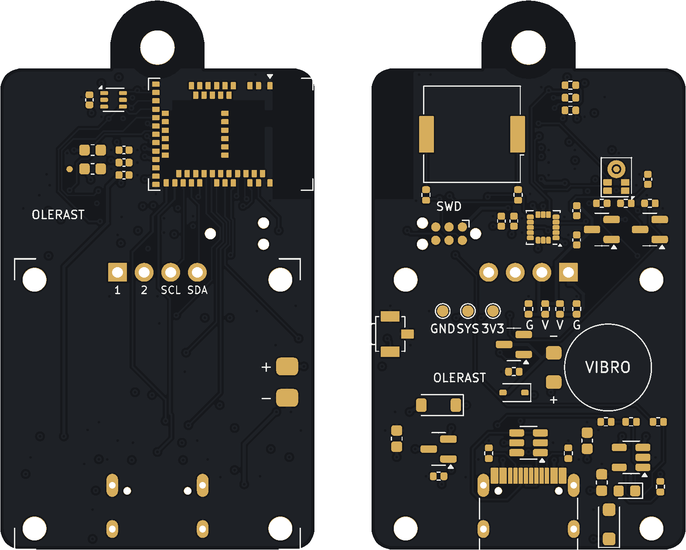

# Плата rev B

> **Статус:** плата разведена заново после проверки перед заказом (номиналы, плавный пуск экрана, R6, R20, ячейка), DRC — 0 ошибок и 0 несоединённых; Gerber, BOM и CPL собраны в `out/`. Перед заказом пройдите список «Что сверить» внизу.

Своя плата брелока: модуль nRF52840 (Raytac MDBT50Q), зарядка Li-Po от USB-C, датчики, пищалка, вибро и кнопка. Модуль экрана SSD1306 0.96″ стоит над ней на стойках, батарея — между ними.



Корпус из акрила под лазерную резку и 3D-просмотр собранного брелока — в [`case/`](case/README.md).

Всё генерируется скриптами из одного описания `gen/netlist.py`: схема, плата, трассировка, Gerber, BOM и CPL. Руками в KiCad ничего не правится.

```sh
cd hardware/rev-b/gen
python3 build.py place     # расставить детали (out/work/place-*.png)
python3 build.py route     # переходные земли и питания, шины питания, Freerouting, доводка, заливки, DRC
python3 build.py fab       # Gerber, сверловка, BOM, CPL, превью → out/
python3 schematic.py       # схема A3 + сверка с netlist.py → out/keychain-rev-b-schematic.pdf
```

Нужны KiCad 7 (`pcbnew` для Python и `kicad-cli`) и Java 21 с [Freerouting](https://github.com/freerouting/freerouting) 2.1: путь к jar — в `FREEROUTING_JAR`.

## Стек и размеры

- **Плата:** 30 × 46 мм и ушко для кольца по центру сверху (полукруг R4.5, отверстие 3.2 мм), 4 слоя, 1.6 мм, углы R2.
- **Верхние 18 мм** — модуль nRF антенной к правому краю и датчик света, который смотрит вперёд. Ниже — модуль экрана.
- **Сбоку стек:** стекло и плата модуля экрана → стойки M2 5 мм, между ними ячейка Li-Po 402025 на вспененном скотче в каптоне → эта плата → детали на обороте.

| Слой | Что на нём |
|---|---|
| L1 (лицевая) | модуль nRF, датчик света, конденсаторы модуля, площадки батареи и штырей экрана; длинные сигналы под батареей |
| L2 | сплошная земля, без разрезов |
| L3 | шины питания: VBUS, VBAT и VSYS по 0.4 мм, VDD 0.3 мм; медленные сигналы; всё остальное место — земля |
| L4 (оборотная) | остальные детали и сигналы |

Ширины по классам цепей (`NETCLASSES`):

| Класс | Цепи | Дорожка | Где |
|---|---|---|---|
| Power | VBUS, VBAT, VSYS | 0.4 мм | L3 |
| Rail | VDD (3.3 В) | 0.3 мм | L3 |
| Supply | питание экрана и мотора | 0.3 мм | L1, L3, L4 |
| USB | D+, D− | 0.18 мм | L1, L4 |
| Default | сигналы, питание микрофона | 0.15 мм | L1, L3, L4 |

Токи здесь до 0.25 А, 0.4 мм во внутреннем слое держит около 0.7 А. Сигналы в L3 опираются на сплошную землю L2 рядом.

Порядок трассировки:

1. Каждая площадка земли получает своё переходное в L2, каждая площадка питания — в L3, с зазорами классов цепей.
2. Шины питания в L3 прокладывает свой трассировщик (`gen/powerroute.py`).
3. Сигналы разводит Freerouting; земля для него — плоскость L2, уже проложенное питание закреплено.
4. Что Freerouting не довёл, прокладывает `gen/fixroute.py` по L1, L3 и L4 с переходными; обрезки и висящие переходные убираются.
5. Заливки земли, сшивка островков, DRC.

Поэтому у питания и земли нет длинных тонких путей по внешним слоям.

## Расстановка по блокам

- **Ушко, лицевая сторона:**
  - модуль;
  - датчик света, его выводы SDA, INT и SCL напротив своих ножек модуля;
  - конденсаторы у ножек питания модуля.
- **Ушко, оборот:**
  - пищалка за модулем, левее антенны;
  - подтяжки шины датчиков;
  - микрофон: его отверстие выходит на лицевую сторону мимо конденсаторов;
  - ключ питания экрана над штырями;
  - акселерометр.
- **Середина, оборот:**
  - площадки программатора Tag-Connect TC2030 и контрольные точки 3V3, SYS, GND;
  - вибромотор с ключом слева;
  - кнопка на правом торце.
- **Низ, оборот:**
  - USB-C с защитой ESD посередине;
  - зарядка слева;
  - разделение питания USB и батареи справа.

Ножки модуля выбраны под эту расстановку (`GPIO` в `netlist.py`). Датчики выведены на левый столбец модуля. Экран, USB, SWD, пищалка, кнопка, вибро и зарядка — на нижний ряд, слева направо в том же порядке, что их блоки. Все сигналы — на внешних площадках или в широких зазорах между ними, тонких дорожек нет.

## Питание и зарядка

- **Зарядка.** MCP73832, 4.2 В, ток задаёт R3: I = 1000 В / R3, 10 кОм — 100 мА. Для ячейки 150–250 мА·ч это не больше 1C.
  - Пока идёт заряд, горит красный светодиод.
  - Статус заряда (открытый сток) приходит на ножку CHG_IO через 10 кОм (R5), на землю — 100 кОм (R20). Читать без подтяжки и только при USB: 0 — заряжается (0.1 В), 1 — заряжен (2.8–3.4 В при VBUS 4.75–5.5 В, SPICE). Без R20 «1» доходила до 3.8 В — выше VDD + 0.3 В.
- **Разделение питания.** Есть USB — система питается через диод Шоттки, а P-MOSFET закрыт. Нет USB — батарея питает систему через открытый MOSFET почти без потерь. Затвор Q1 тянет на землю R6 10 кОм: после отключения USB MOSFET открывается за ~15 мс (со 100 кОм — ~130 мс, и всё это время система жила через его внутренний диод, VSYS падал до 2.5 В при 3.3 В на ячейке), и утечка горячего диода не поднимает VBUS без USB.
- **3.3 В** даёт сам модуль: регулятор REG0 nRF52840, `UICR.REGOUT0 = 3V3`. Прошивка записывает это при первом запуске.
- **Заряд батареи** меряется через внутренний делитель VDDHDIV5, отдельный делитель не нужен.
- **Экран** питается через ключ: прошивка выключает его целиком. C11 стоит между затвором и стоком Q2: бросок тока при включении ~0.14 А вместо 0.6–1.3 А, VSYS не ниже 3.64 В, 3.3 В не проседают (SPICE).
- **Модуль экрана** берётся с LDO на плате (662K / XC6206): он получает VSYS, а это до 4.7 В от USB. Подтяжки SDA/SCL модуля должны идти на выход LDO 3.3 В — прозвоните до пайки.
- **Вибромотор** на 3 В стоит на VSYS (до 4.7 В): прошивка включает его ШИМом 20 кГц со скважностью 3 В / VSYS.

## Заказ на JLCPCB

1. `python3 build.py fab` → `out/keychain-rev-b-gerbers.zip`, `out/keychain-rev-b-bom-jlcpcb.csv`, `out/keychain-rev-b-cpl-jlcpcb.csv`.
2. **PCB:** 4 слоя, 1.6 мм, покрытие ENIG (кнопки и площадки Tag-Connect служат дольше), чёрная маска, контроль импеданса не нужен.
3. **Монтаж:**
   - нужен **Standard PCBA**: детали с двух сторон;
   - BOM и CPL из `out/`;
   - модуль MDBT50Q и кнопку B3U-3100P заказать через Global Sourcing или прислать свои: в каталоге LCSC их нет;
   - **повороты в предпросмотре JLCPCB сверить для каждой полярной детали оборота**: Q1–Q4, U2, U3, U4, U6, D1, D2, LED1, J1. Правило поворота деталей оборота у JLCPCB отличается от KiCad, и ошибка на 180° для Q1, U2, U3 или D1 губительна;
   - микрофон U6 — с портом снизу: попросить не мыть плату или закрыть порт.
4. **Руками** паяются: модуль экрана, ячейка, вибромотор и одна пара перемычек 0 Ом (ниже).

## Ручная сборка

- **Порядок питания экрана.** У модулей 0.96″ бывает `GND VCC SCL SDA` или `VCC GND SCL SDA`.
  - По умолчанию стоят R16 и R18: штырь 1 — GND, штырь 2 — VCC.
  - Для другого модуля их переставляют на R17 и R19. Подписи G и V — на обороте под штырями.
  - Перед пайкой проверьте надписи на своём модуле.
- **Батарея:** ячейка с платой защиты, плюс — на верхнюю площадку «+». Проверьте полярность до пайки.
- **Ножки USB-C** выходят на лицевую сторону под батареей. Откусите их заподлицо и закройте каптоном.
- **Вибромотор** клеится на оборот, провода — на площадки «+» и «−» рядом.
- **Модуль экрана** — на стойки M2 5 мм, штыри обрезать заподлицо.
- **Первая прошивка.** Загрузчик заливается по SWD: площадки на обороте с подписью SWD, кабель Tag-Connect TC2030-CTX-NL к J-Link EDU Mini или четыре провода к Pico debugprobe. Дальше прошивка обновляется по USB файлом `.uf2` или из PlatformIO. Шаги, команды и что проверить на первой плате — в [README прошивки](../../firmware/README.md#плата-rev-b).

## Что сверить перед заказом

- [ ] Размеры купленного модуля экрана: `OLED` в `gen/footprints.py` — плата, ряд штырей, отверстия.
- [ ] Ячейка: размеры и расположение проводов (`CELL`).
- [ ] Номера LCSC с пометкой «сверить» в BOM-инструменте JLCPCB.
- [ ] DRC в KiCad: 0 ошибок и 0 несоединённых (`out/work/drc.rpt`).
- [ ] Повороты полярных деталей оборота в предпросмотре JLCPCB (список выше).
- [ ] Зазор над ячейкой под модулем экрана: на стойках 5 мм под модулем ~3.9 мм без его деталей на обороте. Если ячейка с скотчем толще — стойки 6 мм или ячейка 302025 / 352025.
- [ ] Вилка USB-C в вырезе корпуса: по стандарту корпус вилки 12.35 × 6.5 мм, запас до лицевой рамки почти ноль.
- [ ] Модуль экрана с LDO и подтяжками на 3.3 В (см. «Питание»).

## Проверка перед заказом

- **Номиналы:** «100k» в BOM был с номером LCSC C25086 — это не 100 кОм (у LCSC/JLCPCB он 1 Ом). На R6, R7, R9 и R15 это закоротило бы VBUS, а экран и вибро не работали бы. Теперь C25741 (0402WGF1003TCE, 100 кОм, базовая). Остальные номера проверены.
- **SPICE** (ngspice, модели AO3401A/AO3400A, B5819W, 1N4148WS, светодиод, защитные диоды ножек nRF): включение экрана, переход питания при отключении USB, уровень CHG_IO во всех состояниях зарядника, ключ мотора и выброс, ток пищалки на ножку (пик 2.3 мА, standard drive хватает).
- **Соединения:** схема, плата и `netlist.py` совпадают по всем выводам; ножки модуля — с `board.h` и `variant.h` прошивки; NFC-ножки и сброс не заняты; запретная зона антенны без меди.
- **Бюджет REG0:** экран на VSYS, на 3.3 В — датчики, микрофон, подтяжки, пищалка: 3–4 мА при пределе 25 мА.
- **Прошивка на этой плате** прогоняется в симуляции целиком — модели всех микросхем, две платы и эфир между ними ([README прошивки](../../firmware/README.md#симуляция-платы-целиком)).
