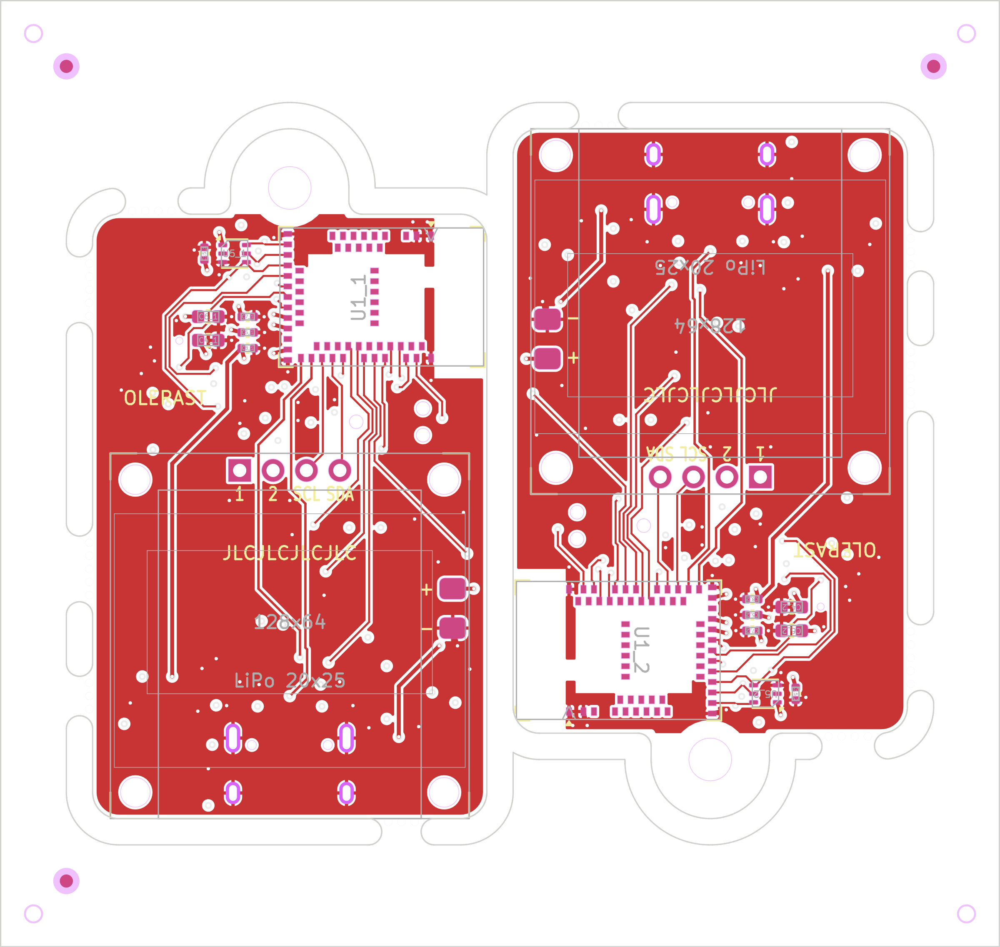

# Плата rev B

> **Статус:** готова к заказу. Перед выпуском плату исправили по полному предрелизному аудиту и независимой проверке: SA0 акселерометра на VDD, ёмкость на выходе REG0 в норме Nordic, перемычки экрана дальше от штырей, заряд по разрешению прошивки, уровень статуса заряда, TVS на VBUS, панель для монтажа, нормы JLCPCB по отверстиям и шёлку ([список](#проверка-перед-заказом)). Переходные 0.25/0.55 мм, переходных в площадках нет. DRC — 0 ошибок, 0 несоединённых, 0 предупреждений (`out/keychain-rev-b-drc.rpt`). Файлы для заказа уже собраны: одна плата — в `out/`, [панель для монтажа](#панель-для-монтажа) — в `out/panel/`. Перед заказом пройдите список [«Что сверить»](#что-сверить-перед-заказом).

Своя плата брелока: модуль nRF52840 (Raytac MDBT50Q), зарядка Li-Po от USB-C, датчики, пищалка, вибро и кнопка. Модуль экрана SSD1306 0.96″ стоит над ней на ушках акриловых рамок корпуса, ячейка — между ними. Как устроена схема и почему так — в [описании железа](../../docs/hardware.md).


Корпус из акрила под лазерную резку и 3D-просмотр собранного брелока — в [`case/`](case/README.md).

Всё генерируется скриптами из одного описания `gen/netlist.py`: схема, плата, трассировка, Gerber, BOM и CPL. Руками в KiCad ничего не правится.

**Для заказа ничего запускать не нужно.** Плата `keychain-rev-b.kicad_pcb` разведена и проверена, файлы для заводов лежат в `out/` и `out/panel/` — их загружают как есть ([JLCPCB](#заказ-на-jlcpcb), [PCBWay](#заказ-на-pcbway)). Скрипты нужны, только чтобы изменить плату:

```sh
cd hardware/rev-b/gen
python3 build.py place --force  # расставить детали заново — плата БЕЗ дорожек (out/work/place-*.png)
python3 build.py route     # переходные земли и питания, шины питания, Freerouting, доводка, заливки, DRC
python3 build.py finish    # доводка разведённой платы без перетрассировки — только проверка, без записи
python3 build.py finish --force  # то же с записью: паста, шёлк и надписи из netlist.py, отверстия
python3 build.py fab       # DRC, Gerber, BOM, CPL, файлы PCBWay, чертежи, превью, панель → out/, out/panel/
python3 build.py panel     # DRC платы, потом только панель → out/panel/
python3 schematic.py       # схема A3 + сверка с netlist.py → out/keychain-rev-b-schematic.pdf
```

- **`place` и `route` заменяют разведённую плату:** `place` — платой без дорожек, `route` — новой разводкой (Freerouting от прогона к прогону разводит по-разному). Поэтому без `--force` оба отказываются, если в плате уже есть дорожки. После `place --force` нужен `route` — уже без `--force`, дорожек ведь нет.
- **`route` и `finish --force` записывают плату только после чистого DRC.** Не прошла — `keychain-rev-b.kicad_pcb` не тронута, а результат для разбора лежит в `out/work/keychain-rev-b-*-failed.kicad_pcb`, отчёт — в `out/work/keychain-rev-b-drc.rpt`. `route` сначала проверяет Java и Freerouting и только потом трогает плату. `finish` без `--force` ничего не пишет: доводит плату в памяти, гоняет DRC и говорит, изменилась бы плата.
- **`fab` сам прогоняет DRC.** Если есть ошибки, несоединённые площадки, в плате нет дорожек или на площадках деталей, которые завод не ставит, есть паста, он ничего не пишет ни в `out/`, ни в `out/panel/`. Панель он собирает раньше файлов одной платы, в черновик `out/work/panel-new`: не собралась или не прошла проверки — `out/` и `out/panel/` не тронуты; собралась — пишутся файлы одной платы, и черновик целиком заменяет `out/panel/`. `build.py panel` сначала так же проверяет плату и только потом собирает панель.
- **Отчёт `out/keychain-rev-b-drc.rpt` пишет только `fab`** и только для платы, которая прошла. Отчёты `route` и `finish` — в `out/work/`.
- **Если что-то пошло не так**, вернуть плату и файлы из репозитория:

  ```sh
  git checkout -- hardware/rev-b/keychain-rev-b.kicad_pcb hardware/rev-b/Keychain.pretty hardware/rev-b/out
  ```

Нужен именно KiCad 7 (`pcbnew` для Python и `kicad-cli`): на KiCad 8 и новее скрипты не работают. Для превью и чертежей — `cairosvg` (`pip install cairosvg`, путь можно дать в `CAIROSVG`) или `rsvg-convert`, и Pillow. Для `route` — Java 21 и [Freerouting](https://github.com/freerouting/freerouting) 2.1, путь к jar — в `FREEROUTING_JAR`. Для панели — [KiKit](https://github.com/yaqwsx/KiKit) 1.5.1 в Python, где виден `pcbnew` KiCad 7:

```sh
python3 -m venv --system-site-packages ~/kikit-venv && ~/kikit-venv/bin/pip install kikit==1.5.1
KIKIT_PYTHON=~/kikit-venv/bin/python python3 build.py fab
```

Без KiKit `fab` останавливается до того, как что-то записать. `build.py fab --no-panel` собирает файлы одной платы и удаляет `out/panel/`: старая панель уже не совпадала бы с платой.

## Стек и размеры

- **Плата:** 30 × 46 мм и ушко для кольца по центру сверху (полукруг R4.5, отверстие 3.2 мм без металлизации), 4 слоя, 1.6 мм, углы R2.
- **Верхние 18 мм** — модуль nRF антенной к правому краю и датчик света, который смотрит вперёд. Ниже — модуль экрана.
- **Сбоку стек:** стекло и плата модуля экрана → две рамки ячейки из акрила, на их ушках лежит модуль, внутри ячейка Li-Po на тонком двустороннем скотче → эта плата → детали на обороте. Покупных стоек нет.
- **Три версии, S, M и L:** ячейки 402025, 502025 и 602025 (~150, ~200 и ~250 мА·ч), под модулем экрана 6, 7 и 8 мм (рамки ячейки 3 + 3, 3 + 4 и 3 + 5 мм). Плата и прошивка у всех одни и те же, винты корпуса у всех M2 × 25. Ячейка подходит, если:

  > толщина ячейки + 0.3 мм (каптон и скотч под ней) + 0.1 мм (каптон на обороте модуля) + 0.3 мм (вздутие) ≤ высота под модулем − самая высокая деталь на обороте модуля

  Толщину ячейки меряют штангенциркулем в самом толстом месте. Высота под модулем — это две рамки ячейки стопкой, тоже по штангенциркулю: листы акрила гуляют на ±0.1–0.3 мм. Пересчёт по вашим листам — `python3 case.py --sheet 3=… --sheet 4=…` в папке `case/`. Деталь на обороте модуля — 1.1–1.45 мм, смерьте свой модуль. Не влезает — версия на ступень выше. Подробно, вместе с гребёнкой экрана и винтами, — в [README корпуса](case/README.md#три-версии-s-m-l).

| Слой | Что на нём |
|---|---|
| L1 (лицевая) | модуль nRF, датчик света, конденсаторы модуля, площадки ячейки и штырей экрана; длинные сигналы под ячейкой |
| L2 | сплошная земля, без разрезов |
| L3 | шины питания: VBUS, VBAT и VSYS по 0.4 мм, VDD 0.3 мм; медленные сигналы; всё остальное место — земля |
| L4 (оборотная) | остальные детали и сигналы |

Ширины по классам цепей (`NETCLASSES`):

| Класс | Цепи | Дорожка | Где |
|---|---|---|---|
| Power | VBUS, VBAT, VSYS | 0.4 мм | L3 |
| Rail | VDD (3.3 В) | 0.3 мм | L3 |
| Supply | питание экрана и мотора | 0.3 мм | L1, L3, L4 |
| USB | D+, D− | 0.18 мм | L1, L4 |
| Default | сигналы, питание микрофона | 0.15 мм | L1, L3, L4 |

Токи здесь до 0.25 А, 0.4 мм во внутреннем слое держит около 0.7 А. Сигналы в L3 опираются на сплошную землю L2 рядом. Переходные — 0.25/0.55 мм (поясок 0.15 мм): это норма и JLCPCB, и PCBWay.

Порядок трассировки:

1. Каждая площадка земли получает своё переходное в L2, каждая площадка питания — в L3, с зазорами классов цепей.
2. Шины питания в L3 прокладывает свой трассировщик (`gen/powerroute.py`).
3. Сигналы разводит Freerouting; земля для него — плоскость L2, уже проложенное питание закреплено.
4. Что Freerouting не довёл, прокладывает `gen/fixroute.py` по L1, L3 и L4 с переходными, но не в площадках деталей; обрезки и висящие переходные убираются.
5. Заливки земли, сшивка островков, DRC.

Поэтому у питания и земли нет длинных тонких путей по внешним слоям.

## Расстановка по блокам

- **Ушко, лицевая сторона:**
  - модуль;
  - датчик света, его выводы SDA, INT и SCL напротив своих ножек модуля;
  - конденсаторы у ножек питания модуля.
- **Ушко, оборот:**
  - пищалка за модулем, левее антенны;
  - подтяжки шины датчиков;
  - микрофон: его отверстие выходит на лицевую сторону мимо конденсаторов;
  - ключ питания экрана над штырями;
  - акселерометр.
- **Середина, оборот:**
  - перемычки порядка питания экрана R16–R19 — в ряд под штырями, почти в 2 мм от них;
  - площадки программатора Tag-Connect TC2030 и контрольные точки 3V3, SYS, GND;
  - вибромотор с ключом слева;
  - кнопка на правом торце.
- **Низ, оборот:**
  - USB-C с защитой ESD посередине, TVS D3 — у разъёма;
  - зарядка слева;
  - разделение питания USB и батареи справа.

Ножки модуля выбраны под эту расстановку (`GPIO` в `netlist.py`). Датчики выведены на левый столбец модуля. Экран, USB, SWD, пищалка, кнопка, вибро и зарядка — на нижний ряд, слева направо в том же порядке, что их блоки. Все сигналы — на внешних площадках или в широких зазорах между ними, тонких дорожек нет.

**Антенна.** Под антенной модуля меди нет ни на одном слое — это зона из документации Raytac (x ≥ 26, y ≤ 12.5 мм). Ниже неё вдоль правого края идут единственным путём сигналы от модуля к SWD и кнопке, поэтому зону вниз не расширяли; угол платы и так открыт с двух сторон. Винт корпуса справа сверху (x 26.75, y 20.2) — всего в 7.7 мм ниже зоны: винты и гайки корпуса берите нейлоновые, M2 × 25 ([что купить](case/README.md#что-купить)). Если нейлоновых M2 × 25 не найти, стальные винты допустимы, а гайки всё равно нейлоновые. Порог сигнала встреч (−70 дБм, [встречи](../../docs/encounters.md)) стоит проверить на собранных брелоках в корпусе.

## Питание и зарядка

- **USB-C.** Резисторы 5.1 кОм на CC1 и CC2 — «я потребитель 5 В». USBLC6 (U3) защищает линии от статики, от выброса на VBUS она не спасает.
- **Выброс при горячем подключении.** Индуктивность кабеля и керамика C1 дают на VBUS звон. По модели в ngspice он заметен только с коротким толстым кабелем (меньше ~0.2 Ом вместе с контактами) от зарядника, у которого 5 В на гнезде есть всегда: VBUS — до 6.2–6.9 В (зарядник 5.0–5.25 В), выше 5.8 В несколько микросекунд. VSYS за диодом D1 на ~0.35 В ниже, но выше 5.8 В может держаться до ~0.3 мс. Предел модуля и на выводе VBUS (на нём C8 100 нФ), и на VDDH (это VSYS) — 5.8 В, так что короткое превышение возможно. Зарядники USB-C по стандарту включают 5 В плавно и только после подключения, такого звона они не дают; длинный тонкий кабель его гасит.
  - **TVS D3 SMF5.0A** (рабочее 5 В, пробой 6.4–7.1 В, катод к VBUS) стоит у разъёма от статики и бросков на входе — ограничитель, которого требует документация MCP7383x. Звон ниже ~6.6 В он не трогает и под 5.8 В его не держит. Срезает только пики, которые ушли бы за предел зарядника 7 В, и то без гарантии.
  - Исправление — гасить звон у J1: RC-цепочка или конденсатор с ESR ~0.5–1 Ом и не меньше 10 мкФ. Это защитит и VBUS модуля, и VDDH, и зарядник; одного резистора 10 Ом перед VBUS модуля мало. Это — в плане rev C, а на первой плате звон меряют осциллографом ([на первых платах](#на-первых-платах)).
- **Зарядка.** MCP73832, 4.2 В, ток задаёт R3: I = 1000 В / R3, 10 кОм — 100 мА. Для ячеек 150–250 мА·ч это не больше 0.7C.
  - **Заряд включает прошивка.** Нижний конец R3 — не на земле, а на ножке P0.24 (CHG_EN, площадка 48 модуля). Ножка в нуле — заряд идёт; ножка отпущена — PROG висит, и зарядник выключен.
  - Прошивка заряжает только при температуре кристалла nRF от 10 до 42 °C и останавливает заряд ниже 7 °C и выше 45 °C (датчик кристалла ошибается до ±5 °C, а на USB кристалл теплее ячейки — поэтому запас у холода). Проверка — сразу при подключении USB и дальше раз в 30 с. У MCP73832 нет входа термистора, а заряжать литиевую ячейку на морозе нельзя. Подробно — в [README прошивки](../../firmware/README.md#зарядка).
  - **Без прошивки заряда нет:** на чистой плате, в загрузчике и до старта прошивки CHG_EN отпущен. Плата при этом работает от USB через D1.
  - Пока идёт заряд, ярко горит красный светодиод.
- **Статус заряда.** Открытый сток STAT приходит на ножку CHG_IO (P0.20) через R5 10 кОм, на землю — R20 47 кОм. Читать без подтяжки и только при USB:
  - «0» — заряжается: не выше 0.82 В (выход STAT в нуле — до 1.0 В);
  - «1» — заряд не идёт или окончен: (VBUS − Vf светодиода) · 47/58 = 2.4–3.3 В при VBUS 4.75–5.5 В и Vf 1.45–1.75 В. На прошитой плате (VDD 3.3 В) это ниже предела ножки VDD + 0.3 В. Без R20 «1» доходила бы до 3.8 В.
  - **Непрошитая плата на USB** (VDD 1.8 В, предел ножки 2.1 В): заряда нет, STAT отпущен, и эти 2.4–3.3 В выше предела. Защитный диод ножки держит её около 2.3 В, через R5 в него идёт до ~0.1 мА. Это только до первой прошивки, которая ставит 3.3 В, и ножке не вредит. Непрошитую плату на USB надолго не оставляйте.
  - **Слабый USB.** «1» читается наверняка, только если на VBUS не меньше ~4.6 В. От слабого источника (старый хаб, слабый пауэрбанк, длинный тонкий кабель) конец заряда может читаться как «заряжается»: сцена зарядки не сменится на «заряжено», процент так и останется 99 %. Сам зарядник при этом заряд заканчивает правильно.
  - Когда заряд не идёт, светодиод слабо тлеет: через него, R5 и R20 течёт 50–70 мкА. Так и задумано.
- **Разделение питания.**
  - Есть USB — система питается через диод Шоттки D1: VSYS = VBUS − 0.15…0.4 В, это **до ~5.4 В**. P-MOSFET Q1 закрыт.
  - Нет USB — R6 10 кОм тянет затвор Q1 на землю, и ячейка питает систему через открытый MOSFET почти без потерь.
  - После отключения USB Q1 открывается за ~15 мс (модель в ngspice; со 100 кОм было бы ~130 мс). Пока он не открылся, система живёт через его внутренний диод, и VSYS на 0.5–0.6 В ниже ячейки. Прошивка поэтому полторы секунды после отключения не верит замеру ячейки.
  - От USB R6 берёт лишние 0.5 мА. Зато утечка нагретого D1 из VSYS в VBUS даёт на нём в 10 раз меньшее напряжение, чем дала бы на 100 кОм; в жару это стоит проверить на первой плате.
- **3.3 В** даёт сам модуль: регулятор REG0 nRF52840 (VDDH = VSYS, VDD — его выход).
  - На чистом чипе REG0 выдаёт 1.8 В. 3.3 В (`UICR.REGOUT0 = 3V3`) записывает заводской файл прошивки или загрузчик при первом запуске.
  - На VDD — C6 4.7 мкФ и четыре по 100 нФ: 5.1 мкФ номинально. Nordic для REG0 допускает не больше ~5.5 мкФ, а на 3.3 В керамика теряет ещё часть ёмкости.
  - Нагрузка REG0 — датчики, микрофон, подтяжки, пищалка: 3–4 мА при пределе 25 мА. Экран и мотор — на VSYS.
- **Заряд ячейки** меряется через внутренний делитель VDDHDIV5, отдельный делитель не нужен.
- **Экран** питается через ключ Q2: прошивка выключает его целиком, а R9 держит его выключенным при сбросе. C11 стоит между затвором и стоком Q2 и включает ключ плавно: бросок тока в конденсаторы модуля по модели в ngspice — не больше ~0.15 А вместо 0.6–1.3 А, VSYS и 3.3 В не проседают.
- **Модуль экрана** берётся с LDO на плате (662K / XC6206): он получает VSYS, а это до ~5.4 В от USB. Подтяжки SDA/SCL модуля должны идти на выход LDO 3.3 В — прозвоните до пайки.
- **Вибромотор** на 3 В стоит на VSYS (до ~5.4 В): прошивка включает его ШИМом 20 кГц со скважностью 3 В / VSYS.

## Программатор (SWD)

- **J3** — площадки под кабель Tag-Connect TC2030 на обороте, с подписью SWD:
  - 1 — VTref (это VDD платы): программатор по ней только *меряет* напряжение платы. Питание на неё не подавать, с выходом 3.3 В программатора не соединять — это выход регулятора модуля;
  - 2 — SWDIO, 4 — SWDCLK, 5 — GND;
  - 3 и 6 не подключены, сброс не выведен.
- **Плату на время прошивки питают от USB-C**, и на заводе тоже. Ячейки на этом шаге может не быть. Ножка статуса заряда на непрошитой плате при этом чуть выше своего предела — это безвредно ([статус заряда](#питание-и-зарядка)).
- **На контрольной точке 3V3 — 1.8 В, пока плата не прошита.** Заводской файл `keychain-revb-factory.hex` ([готовые файлы](../../firmware/release/README.md)) сразу записывает в UICR 3.3 В, и после сброса в конце прошивки на 3V3 уже 3.3 В. Если записан только загрузчик, 3.3 В он ставит сам при первом запуске и перезагружается.
- **Программатор — с уровнями по VTref.** Линии SWD идут к модулю напрямую, а программатор с постоянными 3.3 В (Pico debugprobe, J-Link EDU Mini V1) на плате при 1.8 В гонит ток через защитные диоды выводов.
  - **Для брелоков на продажу** — J-Link BASE или BASE Compact: коммерческая лицензия, уровни по VTref от 1.2 до 5 В. У них разъём 20 контактов 2.54 мм, поэтому к кабелю TC2030-CTX-NL нужен переходник SEGGER 9-Pin Cortex-M Adapter (8.06.02). Или пусть прошивает завод (PCBWay, «Firmware loading»).
  - **J-Link EDU Mini V2** уровни держит правильно, но по лицензии SEGGER он только для некоммерческого использования: прошивать им брелоки на продажу нельзя. Для своих прототипов он подходит, кабель TC2030-CTX-NL втыкается в него прямо.
  - Другие варианты: CMSIS-DAP-программатор с уровнями от 1.2 до 5 В, например NXP MCU-Link Pro с pyOCD. На этой плате он не проверен: сначала прошейте им одну плату. Питание платы от программатора не включайте. Pico debugprobe — только через преобразователь уровней, сторона платы которого питается от VTref, или к плате, которая уже работает при 3.3 В (прошита и был сброс).
  - Кабель, команды и файлы — в [README прошивки](../../firmware/README.md#первая-прошивка-загрузчик-по-swd).

## Панель для монтажа

Детали стоят с двух сторон, а такой монтаж у JLCPCB — только **Standard PCBA**: плата или панель не меньше 70 × 70 мм, с технологическими полями, реперными точками и технологическими отверстиями. Плата меньше (30 × 52.5 мм с ушком), и у двух её краёв почти ничего нельзя — V-cut и полей нет нигде:

- **нижний край:** корпус USB-C J1 выходит за него на ~0.7 мм, TVS D3 — в 0.95 мм от края, в обоих углах — отверстия винтов корпуса. Место есть только для одной короткой перемычки справа, между J1 и винтом;
- **правый край:** толкатель кнопки SW1 выходит на ~0.2 мм, модуль U1 стоит в 0.25 мм от края нарочно (антенна у края). Перемычек здесь нет.

Поэтому панель готова в `out/panel/` (её собирает `gen/panel.py` через KiKit):



- **76 × 72 мм, две платы в ряд.** Вторая повёрнута на 180°: правые края обеих смотрят в общий паз посередине, нижние — в пазы у рамки.
- **Сплошная рамка** вокруг плат, 5 мм снаружи. Между платой и рамкой — фрезерованный паз 2 мм по всему контуру, V-cut нигде нет.
- **Перемычки с mouse bites** — на левом крае каждой платы (три), на верхнем левее ушка (одна) и на нижнем справа, между USB-C и винтом (одна). Так плата держится с трёх сторон, а не только у левого края: JLCPCB советует перемычки по разные стороны платы. Отверстия 0.6 мм, между краями отверстий 0.4 мм — как советует JLCPCB. Перемычки слева — 5, 5 и 3 мм (5, 5 и 3 отверстия), сверху — 4 мм (4 отверстия), снизу — 3 мм (3 отверстия). Узкие стоят там, где у края мало места: между R3 и R4, рядом с C15 и между J1 и винтом (до корпуса J1 — 2.5 мм, скругление паза — в 1.5 мм от его выступа). JLCPCB советует от 5 отверстий, но десяти перемычек на две маленькие платы хватает. Отверстия стоят в самой перемычке, центрами в 0.25 мм за краем платы: заливки платы — в 0.3 мм от края, и сверло подходит к меди не ближе 0.25 мм.
- **Медь у перемычек.** В заливках земли всех слоёв у каждой перемычки — вырез на 0.3 мм от края. Поперёк перемычки нет контура платы, и без выреза любая перезаливка (кнопка B в KiCad, DRC с перезаливкой) довела бы землю до линии разлома. `gen/panel.py` при сборке проверяет это сам, потому что DRC KiCad этого не видит: отверстия mouse bites — не ближе 0.25 мм к меди, медь — не ближе 0.3 мм к линиям разлома, и так же на копии панели после перезаливки.
- **На рамке:** 3 реперные точки с обеих сторон (медь 1 мм, окно 2 мм, центр в 5 мм от краёв панели; JLCPCB просит не ближе 3.85 мм) и 4 технологических отверстия 1.152 мм без металлизации по углам (норма JLCPCB). Другой меди на рамке нет.
- **Обозначения на панели — с номером копии:** `R1_1` на левой плате, `R1_2` на правой, повёрнутой. Так их ждут BOM и CPL панели.
- **DRC панели** — 0 ошибок и 0 несоединённых (`out/panel/keychain-rev-b-panel-drc.rpt`), у перезалитой копии — тоже.

**Обломки перемычек.** После разламывания на краю платы остаются бугорки до ~0.3 мм (до линии центров отверстий и чуть дальше, если перемычка обломилась неровно). Их сошлифовывают надфилем или наждачкой заподлицо с краем: торец платы в корпусе должен быть ровным, как в модели корпуса. Где они, в координатах платы (мм от левого верхнего угла прямоугольника 30 × 46, ушко не в счёт):

| Край | Где |
|---|---|
| левый (x = 0) | y 3.25–8.25, 24.5–29.5 и 35.2–38.2 |
| верхний (y = 0), левее ушка | x 2.5–6.5 |
| нижний (y = 46), между USB-C и правым винтом | x 22.0–25.0 |

У правого края и на ушке обломков нет.

Одна плата без панели (`out/keychain-rev-b-gerbers.zip`) — для заказа голых плат, без монтажа.

## Заказ на JLCPCB

Ничего запускать не нужно: файлы уже в `out/panel/`.

1. **Файлы для монтажа (панель):**
   - `out/panel/keychain-rev-b-panel-gerbers.zip` — панель;
   - `out/panel/keychain-rev-b-panel-bom-jlcpcb.csv` и `out/panel/keychain-rev-b-panel-cpl-jlcpcb.csv` — BOM и CPL на обе платы панели.

   Только голые платы, без монтажа, — `out/keychain-rev-b-gerbers.zip`.
2. **PCB:** 4 слоя, 1.6 мм, покрытие ENIG (кнопки и площадки Tag-Connect служат дольше), чёрная маска, контроль импеданса не нужен. Переходные 0.25/0.55 мм, отверстия разных цепей — не ближе 0.5 мм. Шёлк — обычный: надписи 1.0 мм, линия 0.16 мм.
   - **Номер заказа** (Mark on PCB) — выберите **Order Number (Specify Position)**; в старой форме это «Remove Order Number» → **Specify a location**. Тогда JLCPCB печатает номер на месте метки `JLCJLCJLCJLC`: она шёлком на лицевой стороне под ячейкой (x 10–20, y 25.8 мм), у каждой платы, а значит и у обеих копий на панели. Ячейка и модуль экрана её закрывают. Если этого не выбрать, номер встанет, куда решит завод, а плату видно сквозь прозрачный корпус; метку завод без этого выбора может и не заметить. «Remove Mark» (без номера вовсе) тоже годится, но может стоить дороже — цену покажет форма.
3. **Панель:**
   - Delivery Format — **Panel by Customer**, одна разработка в панели;
   - размер 76 × 72 мм;
   - **PCB Qty — в панелях**, на каждой две платы. Меньше 5 у JLCPCB не заказать: 5 панелей — это 10 плат. Сколько из них собрать, задаётся отдельно, в монтаже;
   - Edge Rails / Fiducials и Tooling Holes — **Added by Customer**: рамка, реперные точки и отверстия уже в файлах;
   - в комментарии к заказу:

     > Customer panel 76 x 72 mm, 2 boards. Routed slots with mouse-bite tabs only; no V-cut anywhere. Frame, fiducials, tooling holes and all tabs are in the files. Please do not add any rails, tabs or V-cuts: the USB-C connector overhangs the boards' bottom edges and the side button overhangs their right edges. The only bottom-edge tab is the short one at the right-hand end, away from the connector.
4. **Монтаж:**
   - нужен **Standard PCBA**: детали с двух сторон;
   - **PCBA Qty — тоже в панелях**, от 2 (4 платы). Например, PCB 5 и PCBA 3 — это 6 собранных плат и 2 голые панели. Сколько плат выйдет, форма покажет сама;
   - BOM и CPL — из `out/panel/`;
   - модуль MDBT50Q и кнопку B3U-3100P заказать через Global Sourcing или прислать свои: в каталоге LCSC их нет;
   - углы в CPL посчитаны по правилу JLCPCB: у оборота угол отражается (180° − θ), потом поправка детали. **Поправки — лучшие догадки**: открытые таблицы (KiBot, kicad-jlcpcb-tools, Fabrication-Toolkit) в них расходятся, на нашем заказе их никто не проверял (таблица и доводы — в `gen/fab.py`). SOT-23 (Q1–Q4) — 180°, так его показывает предпросмотр JLCPCB по отчётам пользователей; SOT-23-6 (U3) — −90°. **U2 (SOT-23-5, C38066) — −90° наугад:** посадочные места SOT-23-5 у JLCPCB повёрнуты по-разному, и нужно либо −90°, либо 180°, а какое место у C38066, мы не видели. **USB-C J1 (C165948) — 180°** по двум давним таблицам, но единственное сообщение о проверке в предпросмотре (проверить его мы не смогли) говорит 0°, то есть разворот на 180°. **U2 и J1 — первые кандидаты на поворот.** Для SW1 и U1 (Global Sourcing) поправки нет вовсе: посадочное место им рисует сама JLCPCB. Поэтому **в предпросмотре JLCPCB сверьте метку первого вывода каждой полярной детали, у обеих копий на панели** (`_1` и `_2`, вторая повёрнута на 180°), и поверните там, что не сходится. Точную поправку потом впишите по номеру LCSC в `JLC_PART_ROTATION` в `gen/fab.py` (как её посчитать — там же) и пересоберите `build.py fab`: следующий заказ уйдёт с верными углами. Что сверять:
     - **оборот** — по `out/panel/keychain-rev-b-panel-assembly-bottom.png` (одна плата — `out/keychain-rev-b-assembly-bottom.png`): Q1–Q4, U2, U3, U4, U6, D1, D2, D3, LED1, J1 и SW1. У SW1 толкатель должен смотреть наружу, за правый край платы: на чертеже панели — в общий паз посередине у обеих копий, на зеркальном чертеже одной платы — влево. Две большие площадки SW1 — у края, маленькая — внутрь. Перевёрнутый J1 сразу видно: лапки корпуса не попадают в отверстия;
     - **лицевая сторона** — по `out/panel/keychain-rev-b-panel-assembly-top.png` (одна плата — `out/keychain-rev-b-assembly-top.png`): U1 — треугольник первого вывода, сторона без площадок (антенна) — к правому краю платы; U5 (LTR-303) — метка первого вывода. У U5 площадки 2 × 3 симметричны, и поворот на 180° выдаёт только метка;
     - ошибка на 180° губительна для Q1, U2, U3, U4, D1 и D3: перевёрнутый TVS D3 — это диод в прямом направлении поперёк VBUS. У перевёрнутого U5 земля датчика сядет на SENS_SDA, и не заработает вся шина датчиков, вместе с акселерометром;
   - микрофон U6 — с портом снизу: попросить не мыть плату или закрыть порт.
5. **Руками** паяются модуль экрана, ячейка и вибромотор ([ниже](#ручная-сборка)). Перемычки R16 и R18 ставит завод; на площадках R17 и R19 пасты нет. Прошивки в этом заказе нет: первую прошивку запишите сами ([программатор](#программатор-swd)).
6. **Платы из панели** выламываются по перемычкам, обломки сошлифовываются заподлицо ([где они](#панель-для-монтажа)).

## Заказ на PCBWay

Ничего запускать не нужно.

1. **Файлы из `out/panel/`** (та же панель, что для JLCPCB):
   - `keychain-rev-b-panel-gerbers.zip` — панель;
   - `keychain-rev-b-panel-bom-pcbway.csv` — производитель, MPN, описание с номиналами, обозначения обеих копий; R17 и R19 — строками DNP;
   - `keychain-rev-b-panel-centroid-pcbway.csv` — расстановка с углами KiCad, без поправок JLCPCB;
   - `keychain-rev-b-panel-assembly-top.png` и `-bottom.png` — сборочные чертежи с метками первого вывода (оборот — зеркально, как его видит монтажник);
   - если завод прошивает платы сам («Firmware loading»), `keychain-revb-factory.hex` из [`firmware/release/`](../../firmware/release/README.md) — сверьте его версию и сумму там же.

   Голые платы без монтажа — `out/keychain-rev-b-gerbers.zip`; файлы одной платы (`out/keychain-rev-b-*`) — на случай, если завод захочет собрать панель сам.
2. **PCB:** 4 слоя, 1.6 мм, ENIG, дорожка/зазор 0.15 мм (6/6 mil), минимальное отверстие 0.25 мм. Переходные 0.25/0.55 мм, поясок 0.15 мм — это норма PCBWay; отверстия меньше 0.3 мм у них с небольшой доплатой.
3. **Панель** — своя («Panel by customer»), 76 × 72 мм, две платы. В комментарии к заказу — тот же текст, что для JLCPCB. Если в форме есть номер заказа или логотип на плате, откажитесь от него: плату видно сквозь корпус. Метка `JLCJLCJLCJLC` под ячейкой PCBWay не мешает — она так и останется надписью, закрытой ячейкой. Технологические отверстия на рамке — 1.152 мм, под JLCPCB; если PCBWay нужны свои (обычно 2–3 мм), на верхней и нижней планках рамки (7.7 мм) для них есть место — попросите добавить.
4. **Монтаж:** Turnkey, детали с двух сторон, SMD и немного THT — у J1 четыре лапки корпуса в отверстиях.
   - MDBT50Q и B3U-3100P завод покупает по MPN. Микрофон SPH0641LM4H-1 в BOM записан на Knowles; эту линейку теперь выпускает Syntiant — если завод не найдёт деталь, подскажите.
   - Микрофон U6 — с портом снизу: попросить не мыть плату или закрыть порт.
   - **Повороты.** В расстановке углы KiCad как есть, а как PCBWay читает углы деталей оборота, у них не опубликовано. Попросите завод подтвердить правило и в их предпросмотре (DFA) сверьте первый вывод каждой полярной детали у обеих копий — те же списки, что для JLCPCB: оборот (Q1–Q4, U2, U3, U4, U6, D1, D2, D3, LED1, J1, SW1) — по `keychain-rev-b-panel-assembly-bottom.png`, лицевая сторона (U1, U5) — по `keychain-rev-b-panel-assembly-top.png`.
5. **Прошивка на заводе («Firmware loading»).** Файл — `keychain-revb-factory.hex` из `firmware/release/` (при своей сборке он называется `firmware-factory.hex`). Площадки SWD — J3 под кабель Tag-Connect TC2030 (разъёма нет): уточните, что завод может так прошить. Плату при этом питают от USB-C 5 В; площадка 1 J3 — только VTref, не питание, а программатор должен работать с уровнями по ней: до сброса в конце прошивки VDD = 1.8 В.
6. **Руками** — то же, что у JLCPCB: модуль экрана, ячейка и вибромотор. Обломки перемычек — сошлифовать.

## Ручная сборка

Вся сборка — по шагам [сборки корпуса](case/README.md#сборка): это единственный подробный порядок, вместе с проверками [первого включения](#первое-включение). Ячейка лежит под модулем экрана, и её площадки модуль закрывает, поэтому порядок именно такой: прошивка, мотор, ячейка, потом экран.

Коротко, с теми же номерами шагов:

1. Прошивка и проверка только от USB-C.
2. Вибромотор — в круг VIBRO на обороте.
3. Ножки USB-C и обломки перемычек панели — заподлицо.
4. Модуль экрана: длинная гребёнка у M и L, каптон на оборот модуля и на шлейф.
5. Ток выключенного брелока, пока ячейки нет, потом ячейка по шаблону из нижней рамки ячейки.
6. Выключение кнопкой 3 с.
7. Перемычки порядка питания экрана: R16 + R18 или R17 + R19, никогда обе пары.
8. Рамки ячейки.
9. Модуль на винтах с шайбами, пайка штырей.
10. Прозвонка VCC–GND, VCC–SCL, SCL–SDA, SCL–GND и SDA–GND до включения, потом кнопка — лицо.
11. Корпус, шаги 11–18: трубка микрофона, рамка экрана, шайбы, крышка, оборот, гайки, проверка.

## Первое включение

Проверки идут по ходу [сборки корпуса](case/README.md#сборка), каждая на своём шаге. Консоль брелока — USB, 115200 бод ([как открыть](../../firmware/release/README.md#какая-прошивка-в-брелоке)). Контрольные точки — на обороте, три круглые площадки с подписями GND, SYS и 3V3 (TP3, TP2, TP1). Что делать, если не так, — [ниже](#если-не-так).

- [ ] **Только USB-C, без ячейки и экрана** (шаг 1, сразу после прошивки).
  - SYS = VBUS − 0.15…0.4 В (до ~5.4 В). 3V3 ≈ 1.8 В на непрошитой плате, ≈ 3.3 В после прошивки и сброса.
  - Консоль: `Брелок с эмоциями, плата rev B, прошивка <версия>. Экран нет, акселерометр есть, свет есть`. Экрана ещё нет, так что «Экран нет» здесь нормально. Версия — та же, что в [`firmware/release/`](../../firmware/release/README.md); команда `ver` её повторит.
  - Светодиод заряда: на непрошитой плате ярко не горит, слабо тлеть может. С прошивкой, но без ячейки он может мигать: зарядник ищет ячейку. Заряд проверяют позже, с ячейкой.
- [ ] **Ток выключенного брелока — меньше 25 мкА** (шаг 5, до пайки ячейки, на каждой плате). Нужен Nordic PPK2.
  - PPK2 — в режиме источника (Source meter), 3.7 В. Тонкими проводами: VOUT — на площадку «+» BT1, GND — на «−». USB отключён.
  - Прошивка запустится сама, без экрана. Удержите кнопку 3 с, подождите 15 с (сцена прощания и звук) и запишите ток за 60 с. Среднее должно быть меньше 25 мкА.
  - Провода отпаяйте: площадки останутся залуженными под ячейку.
  - µCurrent и другой амперметр ставят последовательно между источником 3.7 В и «+» BT1, а не вместо источника. Обычный мультиметр не годится: при переключении предела цепь рвётся, и брелок включается заново.
- [ ] **Прозвонка J2** перед первым включением экрана (шаг 10 [сборки корпуса](case/README.md#сборка)).
- [ ] **Лицо** (шаг 10, после прозвонки). Нажатие кнопки — загрузка, потом лицо; в приветствии консоли — «Экран есть».
- [ ] **Заряд** (с ячейкой, на USB). При 10–42 °C по кристаллу светодиод горит ярко, пока ячейка не зарядится; `sensors` пишет «USB да, заряжается да».
- [ ] Остальное — датчики, звук, встречи — по [списку прошивки](../../firmware/README.md#что-проверить-на-первой-плате).

**Пустая ячейка и хранение.** Брелок выключается сам («Ячейка почти пуста — выключаюсь»), пока в ячейке ещё остаётся ~3.6 мА·ч до отсечки её платы защиты. Выключенный брелок берёт 6–17 мкА (предел на проверке — 25 мкА), так что этого запаса хватит на 9–25 дней. Дальше ячейка разряжается глубже, и это её портит. Зарядите брелок в течение недели. На долгое хранение оставляйте его заряженным примерно наполовину и подзаряжайте раз в 2–3 месяца. Расчёт — в [энергобюджете](../../docs/power.md).

### Если не так

| Что видно | Что делать |
|---|---|
| **SYS около 0 В** при USB-C | Возьмите кабель USB-A → USB-C от компьютера: зарядник USB-C с кабелем C–C даёт 5 В, только когда видит резисторы 5.1 кОм на CC, а при плохой пайке J1 он их не видит. Осмотрите пайку J1 в лупу. Если 5 В есть на конденсаторе C1 (оборот, [сборочный чертёж](out/keychain-rev-b-assembly-bottom.png)), а на SYS нет, виноват диод D1 |
| **SYS есть, 3V3 около 0 В** | Обесточьте плату и прозвоните 3V3–GND (TP1–TP3). Короткий писк — это заряжаются конденсаторы, длинный — замыкание. Замыкание или непропай модуля на плате, собранной заводом, — брак монтажа: плату и фото — заводу |
| **3V3 так и 1.8 В** после прошивки | В UICR не записано 3.3 В: залит файл без загрузчика и UICR (`keychain-revb.hex`, `firmware.hex`) или не было сброса. Запишите именно `keychain-revb-factory.hex`, с `--reset`, потом отключите и снова подключите USB. Проверка: `nrfjprog -f nrf52 --memrd 0x10001304` должен показать `FFFFFFFD` |
| **Нет диска KEYCHAIN** | После `keychain-revb-factory.hex` его и не должно быть: брелок сразу запускает прошивку. Диск появляется только в загрузчике: зажать кнопку и подключить USB или команда `dfu` в консоли. Нет ни диска, ни порта консоли — кабель «только для зарядки» (возьмите другой) или пайка J1 |
| **Нет лица**, в приветствии «Экран нет» | Выключите брелок и отключите USB. Сверьте надписи на модуле (`GND VCC` или `VCC GND`) с перемычками — шаг 7 сборки корпуса; модуль, которому подали питание наоборот, мог сгореть. Осмотрите пайку штырей J2. Прошивка ждёт SSD1306, а под его видом бывают SH1106 и SSD1315 ([экран](../../docs/hardware.md#экран)): с таким модулем лицо может не появиться — возьмите модуль у другого продавца |
| Консоль: **«Шина экрана зажата: SDA или SCL в нуле или замкнуты между собой»** | Брелок работает без экрана: консоль, зарядка и выключение кнопкой действуют. Выключите его (кнопка 3 с) и отключите USB. Ищите каплю припоя между штырями J2 (SCL–SDA, SCL или SDA на GND) в лупу, лишний припой снимите оплёткой. Прозвоните SCL–GND, SDA–GND и SCL–SDA: несколько килоом между SCL и SDA — это подтяжки модуля, норма. Замыкания нет — неисправен модуль, замените. Строка «Шина экрана зажата посреди работы» повторяется — модуль тоже ненадёжен |
| **Лицо было и пропало** | Темно дольше минуты — это режим кармана: экран выключен. Свет, касание или кнопка возвращают лицо |
| **Светодиод заряда не горит**, ячейка есть, USB подключён | Консоль «Заряд не идёт: … °C» — кристалл холоднее 10 °C или жарче 42 °C: согрейте или остудите брелок, проверка раз в 30 с. Виден диск KEYCHAIN — в загрузчике заряда нет: отключите и снова подключите USB. В приветствии нет «прошивка …» или есть «акселерометр нет» — прошивка старая и не заряжает: залейте файл из [`firmware/release/`](../../firmware/release/README.md). `sensors` пишет «заряжается нет», а лицо показывает полный заряд — ячейка уже заряжена |
| Заряд всё идёт, процент стоит на **99 %** | Слабый USB (ниже ~4.6 В на плате): конец заряда читается как «заряжается» ([статус заряда](#питание-и-зарядка)). Возьмите другой зарядник или кабель короче |
| **Ток выключенного больше 25 мкА** | Сначала убедитесь, что брелок правда выключен: экран тёмный, консоль молчит, ток не скачет каждые несколько секунд. Если выключен — утечка: SA0 акселерометра не на VDD или D1 и R6 у VBUS. Это брак монтажа или детали: такую плату не продавайте |

### На первых платах

Эти замеры делают один раз на первых платах партии, не на каждом брелоке.

- **Плата для замеров.** Ток с лицом, в кармане и ток выключенного вместе с экраном меряют на одной плате без ячейки. Соберите её по шагам 1–10 сборки корпуса, но без ячейки: в шаге 5 — только замер тока, шаг 6 не нужен (без ячейки плата и так обесточена). PPK2 в режиме источника, 3.7 В — на контрольные точки на обороте: VOUT на SYS (TP2), GND на GND (TP3). Для платы это то же, что ячейка: без USB ключ Q1 соединяет SYS с площадками ячейки. Точки доступны, пока не надеты рамка оборота и дно. **Пока PPK2 подключён, USB не подключайте:** от USB на SYS выше, чем 3.7 В, и ток пойдёт в выход PPK2. Поставить ячейку в эту плату потом можно, только выпаяв экран.
  - Что мерить и как долго — в [энергобюджете](../../docs/power.md#как-мерить) и [списке прошивки](../../firmware/README.md#что-проверить-на-первой-плате).
  - Ток выключенного с экраном — тоже меньше 25 мкА. Если он заметно больше, чем у этой же платы до экрана, ток утекает через выводы экрана при закрытом ключе.
- **Звон VBUS при горячем подключении** ([почему](#питание-и-зарядка)). Нужен осциллограф от 50 МГц, щуп с пружинкой земли вместо длинного провода. Точки: VBUS модуля — на C8 (лицевая сторона, у модуля nRF), VSYS — на TP2.
  - Запуск — одиночный, по фронту на 5.5 В; развёртка 2 мкс/дел для VBUS и 50 мкс/дел для VSYS.
  - Подключите USB 10 раз самым коротким толстым кабелем от того зарядника, который будете советовать покупателям, и ещё от обычного зарядника USB-A.
  - Запишите пик и время выше 5.8 В. Это замер для rev C: в rev B этот риск принят. Без осциллографа шаг можно пропустить.
- **Зарядник у конца заряда.** C1 и C2 — 10 мкФ 0603, под напряжением их ёмкость падает до ~4–5 мкФ, около минимума MCP73832 (4.7 мкФ). С почти полной ячейкой осциллографом на C2 (VBAT) и C1 (VBUS), оба на обороте: линия должна быть ровной, без пилы или синусоиды больше 0.1 В. Светодиод в конце заряда гаснет и больше не мигает. Если генерирует — сохраните осциллограмму: это пункт для rev C.
- Экран на почти пустой ячейке и датчик света при ярком экране — в [списке прошивки](../../firmware/README.md#что-проверить-на-первой-плате).

## Что сверить перед заказом

- [ ] Размеры купленного модуля экрана: `OLED` в `gen/footprints.py` — плата, ряд штырей, отверстия. Высота самой высокой детали на обороте модуля — от неё зависит зазор над ячейкой.
- [ ] Модуль экрана с LDO и подтяжками на 3.3 В (см. [«Питание»](#питание-и-зарядка)).
- [ ] Ячейка: толщина по правилу [версий S, M, L](#стек-и-размеры), плата защиты, расположение проводов (`CELL`). Не шире 20.7 мм и не длиннее 25.0 мм вместе с плёнкой и платой защиты: гнездо в рамках 21.0 мм, а сверху ячейку подпирает пластик гребёнки. Многие «402025» на деле до 20.5 × 25.5 мм — по длине такая не войдёт ([README корпуса](case/README.md#как-выбрать-ячейку)).
- [ ] TVS D3 SMF5.0A: в BOM-инструменте JLCPCB номер C1509112 должен найтись как SMF5.0A в корпусе SOD-123FL и быть на складе. Иначе выберите другой SMF5.0A в SOD-123FL. Остальные номера LCSC уже сверены (пометка «✓» в `gen/netlist.py`).
- [ ] DRC: `out/keychain-rev-b-drc.rpt` — 0 ошибок, 0 несоединённых, 0 предупреждений; у панели — `out/panel/keychain-rev-b-panel-drc.rpt`. Оба отчёта пишет `build.py fab` и только для платы, которая прошла. Если вы меняли плату, `out/` должен быть собран после последней правки.
- [ ] Панель: заказ «Panel by Customer» из `out/panel/`, текст комментария — из [заказа на JLCPCB](#заказ-на-jlcpcb). V-cut и полей нигде нет, перемычки — только те, что в файлах: у правого края ни одной, у нижнего одна короткая справа.
- [ ] Количество у JLCPCB: PCB Qty — в панелях, от 5; PCBA Qty — сколько панелей собрать, от 2. На панели две платы.
- [ ] Номер заказа у JLCPCB: **Order Number (Specify Position)** («Specify a location») — номер ляжет на метку `JLCJLCJLCJLC` под ячейкой ([заказ](#заказ-на-jlcpcb)).
- [ ] Повороты полярных деталей в предпросмотре завода, с обеих сторон и у обеих копий на панели, первыми — U2 и J1 (их поправки — догадки): оборот (Q1–Q4, U2, U3, U4, U6, D1, D2, D3, LED1, J1, SW1) — по сборочному чертежу оборота, лицевая сторона (U1, U5) — по чертежу лицевой стороны. Найденные поправки — в `JLC_PART_ROTATION` (`gen/fab.py`).
- [ ] Вилка USB-C: окно в корпусе рассчитано на стандартный корпус вилки до 12.35 × 6.5 мм с запасом 0.5 мм. Нестандартно толстые вилки проверьте.
- [ ] Винты корпуса M2 × 25 нейлоновые и гайки нейлоновые; стальные винты — только если нейлоновых не найти, тогда порог встреч проверить в корпусе.
- [ ] Брелоки на продажу — сначала [список перед продажей](../../docs/selling.md): лицензия, свои USB VID/PID, программатор с коммерческой лицензией, радио и ячейка.

## Проверка перед заказом

- **Предрелизный аудит** (что изменилось на плате):
  - SA0 акселерометра (U4, вывод 7) — на VDD, адрес 0x19. На земле через внутреннюю подтяжку всё время, даже в выключенном брелоке, шло бы 0.11–0.16 мА. Прошивка ещё и отключает эту подтяжку (CTRL_REG0 = 0x90).
  - C6 — 4.7 мкФ 16 В (CL10A475KO8NNNC, C19666), C14 и C15 — 100 нФ: ёмкость на выходе REG0 в пределе Nordic.
  - Ряд R16–R19 опущен с y = 21.6 на y = 23.0 мм: голые площадки другой цепи почти в 2 мм от штырей J2.
  - R3 — на CHG_EN (P0.24): заряд только с разрешения прошивки.
  - R20 — 47 кОм: «1» статуса заряда не выше 3.3 В при любом USB.
  - D3 SMF5.0A на VBUS — от статики и бросков на входе; звон при горячем подключении он не ограничивает ([выше](#питание-и-зарядка)).
  - На площадках ячейки и мотора нет пасты: провода паяются руками.
  - В rev B не вошли и перенесены в [план rev C](../../docs/plan.md): гашение звона VBUS у разъёма (вместо 10 Ом перед выводом VBUS модуля), 100 Ом в линиях SWD, запретная зона антенны ниже вдоль правого края.
- **Независимая проверка** (что изменилось после аудита):
  - Панель для монтажа в `out/panel/` ([выше](#панель-для-монтажа)): без неё Standard PCBA у JLCPCB не заказать.
  - Площадки DNP-перемычек R17 и R19 — без пасты: трафарет не печатает на них припой, и капля не замкнёт питание экрана. Так же у всех деталей, которых нет в CPL; `fab` это проверяет.
  - Отверстия разных цепей — не ближе 0.5 мм (норма JLCPCB): правило в `keychain-rev-b.kicad_dru`, его видит DRC. Три переходных сдвинуты на 18–40 мкм, теперь самый малый зазор — 0.512 мм. Трассировщики (`build.py`, `fixroute.py`) эту норму тоже держат.
  - Надписи на шёлке — 1.0 мм, линия 0.16 мм (минимум JLCPCB 1.0 и 0.153 мм), не ближе 0.15 мм к окнам маски: G/V перемычек экрана, 3V3/SYS/GND, SWD, OLERAST, «+»/«−» ячейки и мотора, 1/2/SCL/SDA штырей экрана. Подписи G/V перенесены над перемычки: под R19 места не было. Подписи контрольных точек и штырей экрана — с узким знаком (0.75 мм), чтобы слова не сливались. Контуры деталей из библиотеки KiCad остались линией 0.12 мм.
  - Шёлк посадочных мест обрезан по контуру платы, метка первого вывода U6 — по окну маски R8. DRC больше не выдаёт предупреждений.
  - В CPL для JLCPCB добавлена поправка USB-C J1, у SOT-23-5/6 (U2, U3) поправка теперь −90° (у U2 и J1 это догадки — [заказ на JLCPCB](#заказ-на-jlcpcb)); список проверки в предпросмотре дополнен SW1 и деталями лицевой стороны U1 и U5.
  - `place` не затирает разведённую плату без `--force`, `route` проверяет Java и Freerouting до начала, `fab` не пишет файлы без чистого DRC.
- **Финальная проверка** (что изменилось после независимой):
  - Метка номера заказа JLCPCB `JLCJLCJLCJLC` на лицевой стороне под ячейкой и выбор «Order Number (Specify Position)» в заказе: номер не встанет на виду. Количество в заказе — в панелях, PCB от 5, PCBA от 2.
  - Пятая перемычка панели — на нижнем крае, между USB-C и винтом: плата держится с трёх сторон. Вырезы в заливках у перемычек: перезаливка не доведёт медь до линии разлома; `panel.py` проверяет медь у перемычек сам.
  - `build.py panel` и `fab` проверяют плату раньше, чем тронута `out/panel/`, и собирают панель в черновик; не вышло — `out/` и `out/panel/` как были. `route` без `--force` не трогает разведённую плату, `route` и `finish --force` пишут плату только после чистого DRC, `finish` без `--force` только проверяет. Отчёт в `out/` пишет только `fab`.
  - Поправки поворота U2 и J1 названы догадками, а в `gen/fab.py` есть таблица точных поправок по номеру LCSC (`JLC_PART_ROTATION`) — для заполнения после первого предпросмотра.
- **Номиналы:** «100k» в BOM был с номером LCSC C25086 — это не 100 кОм (у LCSC/JLCPCB он 1 Ом). На R6, R7, R9 и R15 это закоротило бы VBUS, а экран и вибро не работали бы. Теперь C25741 (0402WGF1003TCE, 100 кОм, базовая). Новые номиналы: 47 кОм — C25792, 4.7 мкФ — C19666.
- **Аналоговая часть** — по моделям в ngspice (AO3401A/AO3400A, B5819W, 1N4148WS, светодиод, защитные диоды ножек nRF): включение экрана, переход питания при отключении USB, выброс при горячем подключении, ключ мотора, ток пищалки на ножку (пик 2.3 мА, standard drive хватает). Схемы для ngspice в репозиторий не входят; числа отсюда — оценки, на первой плате их стоит проверить осциллографом. Уровни CHG_IO посчитаны по формуле выше.
- **Соединения:** схема, плата и `netlist.py` совпадают по всем выводам; ножки модуля — с `board.h` и `variant.h` прошивки; NFC-ножки и сброс не заняты; в запретной зоне антенны меди нет.
- **Прошивка на этой плате** прогоняется в симуляции целиком — модели всех микросхем, две платы и эфир между ними ([README прошивки](../../firmware/README.md#симуляция-платы-целиком)).
